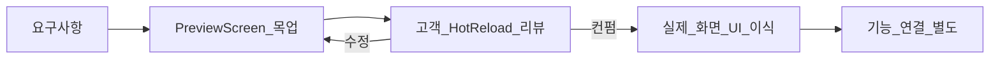

# Yggdrasill Design System

> UI/디자인 관련 작업 전 **반드시** 이 문서를 읽는다.  
> Cursor Rule: [`.cursor/rules/design-system.mdc`](../.cursor/rules/design-system.mdc)  
> 마지막 업데이트: 2026-07-30 | 담당: (고객 — 인터뷰 후 이름 기입)

---

## 0. 에이전트 필수 체크리스트

작업 시작 전 아래를 확인한다.

- [ ] 이 문서(`docs/design-system.md`) 전체를 읽었다
- [ ] 적용 대상 앱을 확인했다 (`yggdrasill` / `yggdrasill_manager`)
- [ ] §6 기준 화면(Golden Screens) 표를 확인했다
- [ ] **Preview 목업**으로만 UI를 작업한다 (고객 컨펌 전 프로덕션 `*_screen.dart` 수정 금지)
- [ ] 문서·기존 상수에 없는 **새 색상 / 폰트 / radius / spacing** 토큰을 만들지 않는다
- [ ] 기존 컴포넌트(§5) 재사용을 우선한다
- [ ] UI 변경과 기능(Provider, API, `onTap` 비즈니스 로직)을 분리한다
- [ ] 작업 완료 후 §10 변경 이력에 한 줄을 추가한다

---

## 1. 브랜드·UX 원칙 (고객 작성 — 인터뷰 후 채움)

아래 항목은 [§ 부록: 고객 인터뷰](#부록-고객-인터뷰-질문) 답변을 받은 뒤 채운다.

| 항목 | 내용 |
|------|------|
| 톤앤매너 | 깔끔, 통일성, 세련됨, ios |
| 정보 밀도 | 보통통 |
| 주 사용자 / 사용 환경 | 학원 선생님 / 13인치 아이패드와 27인치 windows 환경경  |
| 참고 앱·서비스 | spotify,  |
| 피하고 싶은 느낌 | _(미작성)_ |
| 강조색 `#33A373` | _(미작성 — 브랜드 고정 / 추후 변경 가능)_ |
| 절대 하지 말 것 | _(미작성)_ |

---

## 2. 팔레트 (현재 코드 스냅샷 — 추후 교체 용이)

**원칙:** 지금은 **현 상태 유지**. 색은 이 표에 HEX를 기록해 두고, 변경 시 표 → 코드 상수 순으로 동기화한다.  
장기 목표: `lib/theme/` 또는 monorepo `packages/`로 일원화 (아직 미구현).

### 2.1 레거시 메인 셸 (`main.dart` ThemeData)

소스: [`apps/yggdrasill/lib/main.dart`](../apps/yggdrasill/lib/main.dart) (약 L1076–1122)

| 토큰명 | HEX | 용도 |
|--------|-----|------|
| `scaffoldBackground` | `#1F1F1F` | 메인 Scaffold / AppBar 배경 |
| `navRailIndicator` | `#0F467D` | NavigationRail 선택 인디케이터 |
| `fabPrimary` | `#1976D2` | FloatingActionButton |
| `tooltipBg` | `#1F1F1F` | Tooltip 배경 |
| `tooltipBorder` | `Colors.white24` | Tooltip 테두리 |
| `navIconSelected` | `#FFFFFF` | NavRail 선택 아이콘 (size 30) |
| `navIconUnselected` | `#FFFFFF` @ 70% | NavRail 비선택 아이콘 |

**레이아웃 (Theme):**

| 항목 | 값 |
|------|-----|
| AppBar `toolbarHeight` | 80 |
| NavRail `minWidth` | 84 |
| Material | 3 (`useMaterial3: true`) |

### 2.2 신형 다크 틸 (`dialog_tokens` / 패널·다이얼로그)

소스: [`apps/yggdrasill/lib/widgets/dialog_tokens.dart`](../apps/yggdrasill/lib/widgets/dialog_tokens.dart)

| 토큰명 (코드) | HEX | 용도 |
|---------------|-----|------|
| `kDlgBg` | `#0B1112` | 다이얼로그·패널 배경 |
| `kDlgPanelBg` | `#10171A` | 패널 내부 |
| `kDlgFieldBg` | `#15171C` | 입력 필드 배경 |
| `kDlgBorder` | `#223131` | 테두리 |
| `kDlgText` | `#EAF2F2` | 본문 텍스트 |
| `kDlgTextSub` | `#9FB3B3` | 보조 텍스트 |
| `kDlgAccent` | `#33A373` | 강조(초록) |
| `_chipSelected` | `#1B6B63` | 필터 칩 선택 |
| `_chipBg` | `#2A2A2A` | 필터 칩 비선택 배경 |
| `_chipText` | `#CDD5D5` | 필터 칩 비선택 텍스트 |

**동일 팔레트 — private 복제 (`right_side_sheet.dart`):**

| private 상수 | HEX | = dialog_tokens |
|--------------|-----|-----------------|
| `_rsBg` | `#0B1112` | `kDlgBg` |
| `_rsPanelBg` | `#10171A` | `kDlgPanelBg` |
| `_rsFieldBg` | `#15171C` | `kDlgFieldBg` |
| `_rsBorder` | `#223131` | `kDlgBorder` |
| `_rsText` | `#EAF2F2` | `kDlgText` |
| `_rsTextSub` | `#9FB3B3` | `kDlgTextSub` |
| `_rsAccent` | `#33A373` | `kDlgAccent` |

### 2.3 기타 반복 색상

| HEX | 용도 | 소스 |
|-----|------|------|
| `#151C21` | PillTabSelector 트랙 배경 | `pill_tab_selector.dart` |
| `#1B6B63` | PillTab / CustomTabBar 인디케이터 | `pill_tab_selector.dart`, `custom_tab_bar.dart` |
| `#7E8A8A` | PillTab 비선택 라벨 | `pill_tab_selector.dart` |
| `#2A2A2A` | SnackBar 배경 | `app_snackbar.dart` |
| `#0B1112` | CustomNavigationRail 배경, DarkPanelRoute | `navigation_rail.dart`, `dark_panel_route.dart` |
| `#223131` | CustomNavigationRail indicator | `navigation_rail.dart` |
| `#EAF2F2` | CustomNavigationRail 아이콘 | `navigation_rail.dart` |
| `#1976D2` | 업데이트 UI primary (배포) | `tools/RELEASE_GUIDE.md` |
| `#232326` | 업데이트 UI surface (배포) | `tools/RELEASE_GUIDE.md` |

### 2.4 화면 유형별 사용 규칙 (현 상태 유지)

| 화면 유형 | 사용 팔레트 | 비고 |
|-----------|-------------|------|
| 메인 셸 (NavRail, Scaffold, AppBar) | **레거시** §2.1 | `#1F1F1F` — 무단 변경 시 고객 승인 |
| 다이얼로그 / RightSideSheet / DarkPanel / 학습 패널 | **신형 티** §2.2 | `dialog_tokens` / `_rs*` 우선 |
| Pill·밑줄 탭 | §2.3 공통 | `#151C21`, `#1B6B63` |
| SnackBar | `#2A2A2A` | `showAppSnackBar` |
| 신형 Nav (`CustomNavigationRail`) | `#0B1112` 배경 | 레거시 Theme NavRail과 **공존** — 혼용 주의 |

**금지:** 레거시 Scaffold에 신형 틀 배경을 무단 적용하거나, 그 반대 (§9 참고).

### 2.5 동일 HEX 중복 정의 목록 (일원화 대비)

| HEX 세트 | 정의 위치 |
|----------|-----------|
| `kDlg*` 7색 | `dialog_tokens.dart` (canonical) |
| `_rs*` 7색 | `right_side_sheet.dart` |
| `_rs*` 복제 | `file_shortcut_tab.dart` (주석: private 접근 불가로 중복) |
| `_rsBg` 등 | `problem_bank_view.dart` (로컬 static) |

색상 변경 시 **위 파일들을 함께** 검색·동기화할 것.

### 2.6 색상 변경 시 절차

1. 이 문서 §2 표의 HEX 수정
2. `dialog_tokens.dart` 및 §2.5 목록의 중복 파일 동기화
3. Preview 목업에서 영향 화면 스모크 확인
4. 고객 승인 후 프로덕션 반영
5. §10 변경 이력 기록

### 2.7 Light / Dark 대응 원칙

화이트모드 대응은 새 화면부터 **역할 토큰(semantic token)** 기준으로 작성한다.
개별 위젯에서 `Color(0xFF...)`를 직접 고르는 방식은 다크모드 고착을 만든다.

| 역할 | Dark 예시 | Light 예시(초안) | 사용처 |
|------|-----------|------------------|--------|
| `surfaceBase` | `#000000` (확정) | `#FFFFFF` | 화면 배경 |
| `surfacePanel` | `#10171A` | `#FFFFFF` | 카드/패널 |
| `surfaceField` | `#15171C` | `#F0F3F2` | 입력 필드 |
| `borderSubtle` | `#223131` | `#D9E2DF` | 구분선/테두리 |
| `textPrimary` | `#EAF2F2` | `#17201F` | 본문 |
| `textSecondary` | `#9FB3B3` | `#60706D` | 보조 텍스트 |
| `accentPrimary` | `#33A373` | `#1D8B61` | 주요 액션 |

**규칙**

- 새 UI는 `Theme.of(context).colorScheme` 또는 역할 토큰만 사용한다.
- 기존 `kDlg*`, `_rs*`는 Dark 역할 토큰의 현재 구현으로 본다.
- Light 대응 시 화면별 HEX 치환이 아니라, 먼저 역할을 정하고 토큰 값을 교체한다.
- Preview 앱: **Space** — Light / Dark 전환, **Enter**(Dark만) — `surfaceBase` 다크 후보 순환. 토큰: [`ygg_semantic_colors.dart`](../apps/yggdrasill/lib/theme/ygg_semantic_colors.dart).

---

## 3. 타이포그래피

소스: [`main.dart`](../apps/yggdrasill/lib/main.dart), [`pubspec.yaml`](../apps/yggdrasill/pubspec.yaml)

| 역할 | 폰트 패밀리 | Theme / 용도 |
|------|-------------|--------------|
| 본문·라벨 | `KakaoSmallSans` | `fontFamily` 기본, `body*`, `label*` |
| 제목·헤드라인 | `KakaoBigSans` | `display*`, `headline*`, `title*` |
| 문제은행·PDF | `HCRBatang`, `KoPubWorldBatangPro`, `ChosunNm` 등 | 도메인별 — UI 공통 규칙과 분리 |

**코드에서 자주 쓰는 실측 예시:**

| 용도 | fontSize | fontWeight | 출처 |
|------|----------|------------|------|
| 다이얼로그 섹션 제목 | 15 | w800 | `YggDialogSectionHeader` |
| 필터 칩 라벨 | 13 | w600 | `YggDialogFilterChip` |
| PillTab 라벨 | 17 (기본) | w600 | `PillTabSelector` |
| CustomTabBar 라벨 | (탭별) | — | `custom_tab_bar.dart` |

**금지:** UI 화면에 문서·Theme에 없는 새 폰트 패밀리 추가 (도메인 PDF/문제 렌더링 제외).

---

## 4. Spacing & Radius

**허용 spacing 스케일:** `4`, `8`, `10`, `12`, `16`, `24`  
임의 값(예: 13, 17, 19px padding)은 **새 UI에 사용 금지**. 기존 화면에 이미 있으면 Preview 리팩터 시 스케일로 맞출 것.

| 토큰 / 패턴 | 값 | 출처 |
|-------------|-----|------|
| 섹션 헤더 `padding` | `bottom: 10`, `top: 2` | `YggDialogSectionHeader` |
| 섹션 헤더 악센트 바 | `4×16`, radius `2` | `YggDialogSectionHeader` |
| 아이콘 간격 (헤더) | `10`, `8` | `YggDialogSectionHeader` |
| 필터 칩 padding | `horizontal: 14`, `vertical: 8` | `YggDialogFilterChip` |
| 필터 칩 height | `36` | `YggDialogFilterChip` |
| 필터 칩 radius | `18` | `YggDialogFilterChip` |
| 다이얼로그 확인·닫기 | `120×52`, 캡슐 | `AppDialogConfirmButton`, `AppDialogCloseButton` |
| 홈 완료 버튼 | `140×56`, 캡슐 | `AppConfirmButton` |
| PillTab 기본 크기 | `288×48`, padding `4` | `PillTabSelector` |
| PillTab radius | `height/2` (캡슐) | `PillTabSelector` |
| CustomTabBar 높이 | `48` | `CustomTabBar` |
| CustomTabBar 탭 너비·간격 | `120`, gap `21` | `CustomTabBar` |
| CustomTabBar 인디케이터 | `6` 높이, radius `3` | `CustomTabBar` |
| NavRail leading padding | `top: 6`, `bottom: 8` | `navigation_rail.dart` |
| Nav 아이콘 size | `26` (rail), `30` (Theme legacy) | `navigation_rail.dart`, `main.dart` |
| DarkPanel 전환 | `280ms` / `220ms` reverse | `dark_panel_route.dart` |
| 칩 애니메이션 | `160ms` | `YggDialogFilterChip` |
| PillTab 애니메이션 | `250ms`, `easeOutCubic` | `PillTabSelector` |

---

## 5. 컴포넌트 카탈로그 (재사용 우선)

경로 기준: `apps/yggdrasill/lib/widgets/` (unless noted)

| 컴포넌트 | 파일 | 언제 쓰나 |
|----------|------|-----------|
| `YggDialogSectionHeader` | `dialog_tokens.dart` | 다이얼로그 섹션 제목 |
| `YggDialogFilterChip` | `dialog_tokens.dart` | 다이얼로그 필터·토글 칩 |
| `PillTabSelector` | `pill_tab_selector.dart` | Pill + 슬라이딩 인디케이터 탭 |
| `CustomTabBar` | `custom_tab_bar.dart` | 밑줄 인디케이터 탭 |
| `CustomNavigationRail` | `navigation_rail.dart` | 신형 틀 좌측 네비 (`#0B1112`) |
| `DarkPanelRoute` | `dark_panel_route.dart` | 풀스크린 다크 패널 전환 |
| `showAppSnackBar` | `app_snackbar.dart` | 짧은 피드백 메시지 |
| `CustomFormDropdown` | `custom_form_dropdown.dart` | 폼 드롭다운 |
| `ClassCard`, `StudentCard`, `TeacherCard` | `class_card.dart` 등 | 엔티티 카드 |
| `MainFab` / `MainFabAlternative` | `main_fab.dart` 등 | FAB 패턴 |
| `AppConfirmButton` | `app_confirm_button.dart` | 홈 우하단 큰 확인(140×56) |
| `AppDialogConfirmButton`, `AppDialogCloseButton` | `app_dialog_action_button.dart` | 다이얼로그·시트 안의 작은 확인/닫기(120×52) |
| RightSideSheet 계열 | `right_side_sheet/` | 우측 시트·채점·메모 |
| PDF 다이얼로그 | `pdf/*.dart` | 교재·숙제 뷰어 |
| `CoverOverlayStyle`, `CoverScrim`, `CoverHairline`, `CoverPill` | `cover_overlay.dart` | 표지 이미지 위에 정보를 올리는 카드 (§5.1) |
| `TimetableCell`, `TimetableCapacityBand` | `screens/timetable/views/components/timetable_cell.dart` | 시간표 칸·인원 단계 띠·오버레이 칩 (§5.2) |
| `ConceptTypeChip`, `ConceptTypeTag`, `ConceptTypeBar`, `ConceptTypeFilterChip`, `conceptTypeStyle` | 매니저 `screens/curriculum/widgets/concept_type_chip.dart` | 개념 유형 표시(색·앞 글자). 개념 유형을 보이는 곳은 새로 만들지 말고 이것을 쓴다 |

**금지:** 위와 **동일 역할**의 새 위젯을 임의 생성. 필요 시 기존 위젯 확장 또는 고객 승인.

**아이콘:** `material_symbols_icons` (`Symbols.*`) — Material Icons와 혼용 시 기존 화면 톤 유지.

### 5.1 표지 오버레이 카드 (고객 승인 스타일, 2026-10-08)

교재 표지·출력물·단색 배경 **위에 글자를 직접 올리는** 카드는 모두 이 규칙을 따른다.
기준 구현: 채점모드 과제카드(`_SubmittedHomeworkCard._buildCoverArea`)와 정답리스트 교재 카드(`_GradingAnswerBookCard`), 둘 다 `grading_mode_page.dart`.
새 화면에서도 같은 위젯(`cover_overlay.dart`)을 가져다 쓰고, 색·알파값을 화면에서 새로 고르지 않는다.

**핵심 원칙**

1. **표지는 가리지 않는다.** 전체를 덮는 어두운 막 대신 위·아래 **띠만** 어둡게 한다(`CoverScrim`). 표지 중앙은 원본 그대로 보인다.
2. **정보는 위·아래 두 묶음.** 위쪽은 카드를 **고르는 기준**(학생 이름, 상태 배지, 학년), 아래쪽은 카드의 **내용**(페이지·과제번호, 교재명·설명). 가운데 영역에는 글자를 두지 않는다. 채점 과제카드의 경과·숙제 배지는 이름과 같은 줄의 오른쪽 끝이다.
3. **한 줄 정렬.** 모든 정보는 같은 여백 안에서 **왼쪽 정렬**한다. 가운데 정렬·오른쪽 끝 단독 배치를 섞지 않는다. 예외는 채점 과제카드의 경과·숙제 배지뿐이다.
4. **짧은 값은 배지로.** 경과시간·종류·번호·학년처럼 짧은 값은 글자만 띄우지 말고 `CoverPill`에 넣는다. 배지가 대비를 보장하므로 어떤 표지에서도 읽힌다.
5. **글자 그림자는 은은하게.** 흰 글자에만 `blur 10, 검정 42%(이미지) / 18%(단색)`. 진한 외곽 그림자 금지.
6. **밝은 표지는 반전.** 출력물·밝은 단색 표지는 흰 띠 + 검은 글자(`#111418`) + 흰 배지로 자동 전환(`CoverOverlayStyle.onDark = false`).

**수치**

| 항목 | 값 |
|------|-----|
| 카드 반경 | `FabTabBarTokens.previewAcademyGroupedCardRadius` (28) — 자료메뉴 교재 카드와 동일 |
| 가장자리 여백 | `16` (카드 축소 시 `CoverOverlayStyle.padFor(scale)`, 최소 10) |
| 묶음 안 간격 | `8` (`gapFor(scale)`, 최소 5), 같은 종류 여러 줄 사이 `2` |
| 채점 과제카드 위쪽 | 경과·숙제 배지는 학생 이름과 같은 줄의 오른쪽. 이름이 길면 배지 앞 간격은 아래 페이지와 과제번호 배지 사이와 같이 `gap + 2`. 과제번호 배지는 글자 너비 |
| 위 띠 | 0 → 40% 지점에서 투명, 시작 알파 이미지 0.66 / 단색 0.30 / 밝은 표지(흰색) 0.88. 채점 과제카드·정답책 카드는 `showTop: false`(롤백 시 true) |
| 아래 띠 | 56% 지점부터, 끝 알파 이미지 0.78 / 단색 0.36 / 밝은 표지(흰색) 0.92. 아래 글이 많으면 `bottomStart`를 앞당긴다(정답카드 0.42) |
| 안쪽 테두리 | 1px, 흰색 10% (밝은 표지 검정 8%), 카드와 같은 반경 |
| 제목 | `previewAcademyMainTitleStyle` 32 w700, 자간 -0.4 (`titleStyle(context)`) |
| 본문 줄(페이지 등) | Pretendard 22 w700, 자간 -0.2, 숫자 고정폭. 채점 과제카드 페이지 글자만 왼쪽 2 |
| 설명 문단 | Pretendard 20 w400, 흰색 82% (`inkSecondary`) |
| 배지 | 높이 32 캡슐, 좌우 12(아이콘 있으면 왼쪽 10), Pretendard 17 w600, 아이콘 17 + 간격 6 |
| 배지 neutral | 검정 46% + 흰 테두리 16% (밝은 표지: 흰색 86% + 검정 테두리 8%) |
| 배지 accent | `#0F2A20` 88% + `kDlgAccent` 테두리 60%, 글자 `#9FE3C6`, 앞에 7px 점 (밝은 표지: `#E8F6EF` + 글자 `kDlgAccent`) |
| 식별 코드 배지 | `emphasize: true` → w700, 자간 0.8 |

**하지 말 것**

- 배지에 블러(`BackdropFilter`)를 쓰지 않는다. 카드가 여러 장 겹치는 목록에서 스크롤이 버벅인다.
- 표지 전체를 30% 이상 덮는 단색 막을 깔지 않는다(확인 대기·여는 중 같은 **상태 표시용 막은 예외**).
- 배지 종류를 늘릴 때 새 색을 만들지 말고 `CoverPillTone`(neutral / accent)에 먼저 맞춰 본다. 꼭 필요하면 tone을 추가하고 이 표를 갱신한다.

**사용 예**

```dart
final overlay = CoverOverlayStyle(onDark: !useDarkText, hasImage: hasImage);
Stack(fit: StackFit.expand, children: [
  coverImage,
  Positioned.fill(child: CoverScrim(style: overlay)),
  Positioned.fill(child: CoverHairline(style: overlay, radius: 28)),
  Positioned(left: 16, right: 16, top: 16, child: /* 제목 + CoverPill */),
  Positioned(left: 16, right: 16, bottom: 16, child: /* 본문 줄 + CoverPill */),
]);
```

### 5.2 시간표 인원 표시 — 단계 띠 (고객 승인 스타일, 2026-10-08)

시간 메뉴 시간표(`classes_view.dart` + `components/timetable_cell.dart`)의 시간대별 인원은 **3단계 띠**로 보여 준다.
비교 시안: Preview 허브의 `timetable_capacity_preview_screen.dart`(현재 히트맵 / ① 70% 통일 / ② 선 제거 / ③ 추천 중 ③ 채택).
1명 단위로 밝기를 바꾸던 히트맵은 칸마다 색이 달라 눈이 어지러워서 폐기했다.

**색 규칙 (세 가지뿐)**

| 의미 | 색 |
|------|-----|
| 인원 양 | 회색조 2단계만: 여유(정원 70% 미만) ink 6%, 혼잡(70~99%) ink 15% (다크: 흰색, 라이트: 검정) |
| 지금·오늘·선택 | `kDlgAccent` 초록 |
| 정원 도달 | 앰버 `#F2B45B` — 정원에 닿았을 때만 |

**수치**

| 항목 | 값 |
|------|-----|
| 단계 | `timetableCapacityLevel(인원, 정원)` — 0 비어 있음 / 1 여유 / 2 혼잡 / 3 정원. 정원은 `academySettings.defaultCapacity` |
| 띠 | 같은 단계가 이어지는 칸을 `TimetableCapacityBand` 하나로 묶는다. 위·아래 여백 `kTimetableBandInset`(6), 양 끝 3, 반경 10. 요일 행 Stack에서 칸 **뒤**에 그린다 |
| 정원 띠 | 앰버 16% 바탕 + 앰버 55% 테두리 1px |
| 세로선 | 정시(:00) 칸 왼쪽에만, `divider` 60%. 30분 칸 선은 없다 |
| 인원 숫자 | 왼쪽 12, 위 13, Pretendard 13 w700, 숫자 고정폭. 띠 시작 칸은 `panelStyle.title`(정원 띠는 앰버), 띠 안에서 인원이 바뀐 칸·마우스가 올라간 칸은 `hint`, 나머지는 숨김 |
| 시간 축 | 칸 숫자와 같은 왼쪽 12에 정렬. 정시 15 w700, 30분 13 w500, 모두 `hint`(지금은 초록), Pretendard 숫자 고정폭 |
| 요일 | Pretendard 17 w700 (`요일` 머리글은 13 w600 `hint`) |
| 호버 열 | 같은 시간 열 전체에 ink 3% |
| 휴식 | 사선(간격 10, ink 6%) + `휴식` 13 w600 `hint` |
| 선택·등록 대기 | `kDlgAccent` 12%, 드래그 중 파랑 18% (기존 동작 유지) |
| 보강·추가·시범·문의 칩 | 같은 모양 하나: 높이 27 캡슐, ink 6% 바탕 + ink 10% 테두리, 아이콘 14(`hint`) + 간격 6 + 글자 12.5 w600. 완료는 투명도 45%. 종류는 **아이콘으로만** 구분(보강 `replay`, 추가 `add`, 시범 `auto_awesome`, 문의 `help_outline`) |

**하지 말 것**

- 인원 구간마다 색을 바꾸지 않는다(초록·노랑·빨강 단계 금지). 양은 밝기, 경고는 앰버 하나.
- 인원 1명마다 밝기를 바꾸지 않는다. 회색은 여유·혼잡 2단계만 쓴다.
- 30분 칸마다 세로선을 다시 긋지 않는다. 띠가 끊겨 보인다.
- 칩 종류별로 바탕색을 다르게 주지 않는다. 구분은 아이콘이 맡는다.
- 칸 위에 별도 막대·리본·배지를 겹쳐 인원을 다시 표시하지 않는다.

---

## 6. 기준 화면 (Golden Screens) — 고객이 채움

디자인·리팩터 시 **이 화면들의 밀도·색·컴포넌트 사용을 우선 복제**한다.

| 화면명 | 파일 경로 | 왜 기준인가 | 스크린샷 |
|--------|-----------|-------------|----------|
| _(비어 있음)_ | | | |
| _(비어 있음)_ | | | |
| _(비어 있음)_ | | | |

**손대면 안 되는 화면 (레거시 유지):**

| 화면명 | 파일 경로 | 사유 |
|--------|-----------|------|
| _(비어 있음)_ | | |

---

## 7. Preview 목업 워크플로 (필수)



### 규칙

1. UI 변경은 **`lib/screens/design_preview/`** 또는 **`*_preview_screen.dart`** 에서 먼저 수행한다.
2. **mock 데이터만** 사용한다. Provider / API / 비즈니스 `onTap` 연결 금지.
3. **고객 컨펌 전** 프로덕션 `*_screen.dart` 및 기능 로직 파일 수정 금지.
4. 컨펌 후: **UI 위젯 트리만** 이식하고, diff는 최소화한다.
5. 기능 연결(상태, API)은 **별도 작업**으로 분리한다.

### Preview 실행 (완전 분리)

Preview는 본앱과 같은 `build/windows/.../Debug` 산출물을 공유하지 않도록
**별도 Flutter 앱**에서 실행한다.

```powershell
cd apps\yggdrasill_design_preview
flutter run -d windows
```

본앱 실행과 Preview 실행은 서로 다른 Flutter 프로젝트이므로 Windows DLL 잠금 충돌을 피한다.

시안 개수: 한 Preview 화면에 **최대 2~3안(A/B/C)**. 그 이상은 통일성 저하.

### 에이전트 프롬프트 템플릿

```text
docs/design-system.md를 먼저 읽고 준수해.
Preview 목업만 만들고, 프로덕션 *_screen.dart는 건드리지 마.
새 색상/폰트/spacing/radius를 만들지 말고 문서 §2~§4와 기존 위젯(§5)만 사용해.
기능 로직(Provider, API, onTap)은 연결하지 마.
```

### Preview 폴더 구조 (앱·M5 분리)

**학습앱** — `apps/yggdrasill/lib/screens/design_preview/`

```
design_preview/
  design_preview_hub_screen.dart
  yggdrasill/                    # 학습앱 화면 (설정 등)
    settings/
      settings_preview_screen.dart
  m5/                            # M5 기기 UI (바인딩 히스토리 등)
    README.md
```

**매니저앱** — `apps/yggdrasill_manager/lib/screens/design_preview/`

```
design_preview/
  design_preview_hub_screen.dart
  yggdrasill_manager/
    settings/
      management_settings_preview_screen.dart
```

**별도 창 (권장 — 실사용 디버그 앱과 동시 실행):**

| 터미널 | 명령 |
|--------|------|
| 본앱 | `cd apps\yggdrasill; flutter run -d windows` |
| 디자인 Preview | `cd apps\yggdrasill_design_preview; flutter run -d windows` |

Preview 루트에서 **학습앱 Preview** 또는 **매니저앱 Preview**를 선택한다.

---

## 8. 앱별 차이

| 항목 | yggdrasill | yggdrasill_manager |
|------|------------|-------------------|
| Scaffold 배경 | `#1F1F1F` + 신형 틀 혼용 | `#1F1F1F` |
| ColorScheme seed | (Theme 직접 색) | `#33A373` |
| 폰트 | KakaoSmallSans / KakaoBigSans | 동일 |
| dialog_tokens | 사용 | (화면별 확인) |
| 공통 규칙 | §2~§7 | §2~§7 + 본 표 |

매니저 앱 전용 예외는 추후 §8에 추가한다.

---

## 9. 안티패턴 (하지 말 것)

- 스크린샷·Figma만 보고 레이아웃 **전면 재설계** (기능 맥락 무시)
- 문서·`dialog_tokens`에 없는 `Color(0xFF...)` **신규 하드코딩**
- 레거시 Scaffold ↔ 신형 틀 팔레트 **무단 교차 적용**
- UI 작업 PR에 Provider / API / 대규모 `onPressed` 로직 변경 포함
- 동일 역할 위젯 중복 생성 (§5 무시)
- 컨펌 없이 프로덕션 화면 직접 수정
- spacing 스케일(§4) 밖 임의 값 남발

---

## 10. 변경 이력

| 날짜 | 변경 | 승인자 |
|------|------|--------|
| 2026-05-29 | 초안 생성 (코드 스냅샷, Preview 워크플로, Cursor Rule 연동) | — |
| 2026-05-29 | Preview 폴더 분리 (yggdrasill / manager / m5), 설정 목업·kDebugMode 라우트 | — |
| 2026-05-30 | 앱 내부 Preview 진입점 실험 (이후 완전 분리 방식으로 대체) | — |
| 2026-05-31 | `apps/yggdrasill_design_preview` 완전 분리 Preview 앱 생성 | — |
| 2026-06-02 | Preview 앱 Space 키 Light/Dark 전환, Light/Dark 역할 토큰 원칙 추가 | — |
| 2026-06-02 | `surfaceBase` ThemeExtension·Preview Enter 순환(`#0B1112`/`#1F1F1F`/`#000000`), Light `#FFFFFF` | — |
| 2026-06-02 | `surfaceBase` Dark `#000000` 확정, 설정 탭(학원/선생님/일반) 배경 토큰 적용 | — |
| 2026-06-03 | 채점모드 과제 카드: 문제은행 출처(추출 교재)는 표지 대신 어두운 회색(`#2B2B2B`) 배경 | — |
| 2026-06-03 | Preview 설정·학원 탭: 기준 본문 `16` (`FabTabBarTokens.previewAcademyBaseFontSize`), FAB 탭 라벨 동일 | — |
| 2026-06-26 | 매니저앱 문항 로드맵 초안 편집 화면 추가 | — |
| 2026-07-23 | 홈메뉴 숙제 초안: 효과가 이어지는 컴팩트 확장, 3줄 마감일, 우측 정렬 `숙제 내기` 버튼 | — |
| 2026-07-26 | 과제 추가 다이얼로그: 하위과제 리스트를 우측 패널에 임베드, 자동/수동 UI 분기, 교재 트리 뒤로가기 | — |
| 2026-07-30 | 홈 상단 출석 순위: `showUtilityGlassDialog` + 점수 점분포(beeswarm) | — |
| 2026-08-23 | 시간제한 테스트: 앱 과제양식 기본값, 제출 문항 수·현재 순번·남은 시간 중심 학생 응시 UI | 사용자 |
| 2026-08-23 | 채점 정답 리스트: 페이지를 카드와 같은 행이 아니라 가로선+본문색 섹션 구획으로 표시 | 사용자 |
| 2026-08-23 | 채점 시트: 같은 학생·교재의 아래 과제가 있으면 확인 후 연속 전환하는 `다음` 버튼 표시 | 사용자 |
| 2026-08-23 | 채점모드: 숙제 검사에서도 `다음` 연속 전환 지원, 당일 배정 미제출 숙제는 숨김 | 사용자 |
| 2026-09-28 | 매니저앱 Think 화면(대화·기억·사용량 탭) 추가, 설정 화면 OpenAI 키 입력 카드를 서버 비밀값 안내로 교체. 기존 매니저 팔레트만 사용 | 사용자(Preview 생략 요청) |
| 2026-09-29 | Think 대화 목록을 정리 트리(정리 안 됨·주제 폴더·발췌, 36px 행, 깊이당 16 들여쓰기, 끌어 옮기기)로 교체. 960px 미만에서는 56px 접힘 막대. 답변 머리에 제외·발췌 버튼, 제외 문답은 50% 투명. 기존 Think 팔레트만 사용 | 사용자(Preview 생략 요청) |
| 2026-09-29 | Think에 "코드 조사" 탭 추가(420px 요청 목록 + 상세, 상태 배지, 작업자 켜짐 점, 결과·제안·원문 접기). 답변 머리에 "코드 조사 요청" 버튼, 요청 작성 창(640px), 사용량 탭에 하루 한도 칸. 기존 Think 팔레트·간격만 사용 | 사용자(Preview 생략 요청) |
| 2026-09-30 | Think "코드 조사" 탭 제거, 채팅 안 카드(최대 760px, 반경 12)로 통합: 코드 조사·수정 제안, 코드 요청 진행·결과·diff(파일별 접기), 대화 분류 제안, 삭제 확인(빨간 테두리). 처리된 제안은 한 줄로 접음. 트리에 제안 폴더 강조(초록 테두리 + "제안")와 새 폴더 흐린 행, 맥락 패널에 "코드 작업" 칸, "전체 코드 요청" 창. 기존 Think 팔레트만 사용 | — (Preview 생략, 사용자 확인 필요) |
| 2026-10-01 | Think 채팅 카드에 "Cursor와 조율"(악수 아이콘, 회차 N/3, 회차별 "Think가 보낸 질문·반론")과 "조율본" 승인 카드(갈린 점은 인용 배경 상자에 Think/Cursor 두 줄, "정해 주셔야 할 것", 이대로 구현·고쳐서 구현·거절) 추가. 기존 카드 틀·Think 팔레트만 사용 | — (Preview 생략, 사용자 확인 필요) |
| 2026-10-02 | 조율본 카드에 객관식 질문 칸 추가: "질문 n" 머리, 보기 행(반경 8, 테두리 `kThinkBorder`/선택 시 `kThinkAccent`, 선택 배경 `kThinkQuote`, 라디오 아이콘 18, "추천" 배지 `kThinkSuccess`, 설명 12px), 직접 입력 칸(`thinkInputDecoration`), "n/m개 답함". 기존 Think 팔레트·간격(4/8/12/16)만 사용 | — (Preview 생략, 사용자 확인 필요) |
| 2026-10-05 | 코드 수정 카드: 끝나지 못한 수정(확인 필요·실패·취소)에 "같은 내용으로 다시 수정" 보조 버튼(`thinkOutlineButton`, `Icons.replay`)과 확인 창 추가 | — (Preview 생략, 사용자 확인 필요) |
| 2026-10-07 | 코드 수정 카드: "자동 검사" 칸(요약 한 줄 12px 굵게, 항목 줄 아이콘 16 + 이름·상태·이유, 상태색 통과 `kThinkSuccess`·실패 `kThinkError`·미실행 `kThinkHint`·원래도 실패 `kThinkLink`, 실패 항목은 펼침, 출력 상자 `kThinkQuote` 반경 8·최대 높이 240), 준비됨 안내를 검사 결과별 색으로, 적용 확인 창 맨 위 경고와 실패 시 빨간 "그래도 적용", 재수정 카드 머리 "검사 실패로 다시 고침 n회째". diff 영역 "검증 보고" 버튼 제거. 기존 Think 팔레트·간격만 사용 | — (Preview 생략, 사용자 확인 필요) |
| 2026-10-07 | 학습앱 하원 다이얼로그를 숙제 선택 창에서 요약 창으로 교체(`departure_summary_dialog.dart`): `UtilityGlassDialogShell`(반경 28) 안에 요약 한 줄, "숙제로 나감"·"다음 수업으로"(흐리게) 그룹 카드(`cardBg`/`cardBorder`), 검사일 칩, 알림장 칸(인쇄 스위치·미리보기·행동 체크/± 카운터), 하단 취소(Outlined)·하원(Filled `kDlgAccent`, Stadium 44). `YggDialogColors`·간격 4/8/10/12/16/24만 사용 | — (Preview 생략, 사용자 확인 필요) |
| 2026-10-08 | Think 채팅: 코드 블록(회색 상자 `kThinkField` 반경 8, 안쪽 12)을 가로 스크롤 대신 상자 폭을 채우고 긴 줄을 접게 바꿈(상자 안 어디서 끌어도 선택·복사). 입력창 안내에 "이미지는 Ctrl+V", 파일 없이 놓인 드롭은 오류 스낵바로 안내. 코드 카드에 "이어받는 앞 수정"·"이어받은 패치" 줄(12px `kThinkSub`, 안내 `kThinkHint`). 기존 Think 팔레트·간격만 사용 | — (Preview 생략, 사용자 확인 필요) |
| 2026-10-08 | 표지 오버레이 카드 규칙(§5.1)과 공용 위젯 `cover_overlay.dart` 추가. 채점모드 과제카드: 위·아래 띠 스크림, 이름 왼쪽 정렬, 경과시간(`n분 전`)·숙제·과제번호를 32px 캡슐 배지로, 페이지·과제번호를 아래쪽으로. 정답리스트 교재 카드: 반경 14→28, 같은 스크림·테두리, 학년 배지를 왼쪽 위 캡슐로(학년 여러 개면 전환 아이콘) | 사용자(Preview 생략 요청) |
| 2026-10-08 | 시간표 인원 표시를 히트맵으로 교체(§5.2): 칸 밝기 = 인원 ÷ 정원, 정원 도달만 앰버, 인원 숫자는 왼쪽 위(변화 시만 밝게), 호버 열 표시, 휴식 사선. 기존 막대·리본 표시 제거. 보강·추가·시범·문의 칩을 아이콘 + 중립 캡슐 하나로 통일 | 사용자(Preview B안 선택) |
| 2026-10-08 | 히트맵이 어지러워 단계 띠로 교체(§5.2): 회색 2단계(여유·혼잡) + 정원 앰버, 같은 단계는 둥근 띠 하나로, 세로선은 정시만, 숫자는 띠 시작(밝게)·띠 안 변화(흐리게)만. 시간 축을 칸 숫자 선에 왼쪽 정렬(정시 15 w700 / 30분 13 w500), 요일 17 w700, 모두 Pretendard | 사용자(Preview ③ 선택) |
| 2026-10-09 | Think 대화 나누기: 나누기 카드(다섯 칸 요약, 빈 칸은 `kThinkHint` "없음", 나눠서 이어가기·고쳐서 나누기·여기서 계속하기, 막힌 이유 문구, 만료·거절은 한 줄), 고치기 창(제목·폴더·요약 다섯 칸), 나눈 대화 위쪽 안내(`kThinkQuote` 반경 8, `Icons.call_split`, 요약 접기·최대 높이 280, "원본 대화로 가기"), 복사한 메시지 위 "원본 대화에서 복사한 메시지" 줄, 맥락 패널 "대화 나누기" 칸(기능 상태·제안 받기 토글·"연결·기능 상태 보기" 버튼), 상태 창 "기능 상태"(사용 가능 `kThinkSuccess` / 준비 필요 `kThinkLink` / 확인 불가 `kThinkError`). 기존 Think 팔레트·간격만 사용 | — (Preview 생략, 사용자 확인 필요) |
| 2026-10-10 | Think 커서 문의: Cursor가 보낸 질문 위에 `Icons.smart_toy_outlined` 14 + 배지 "커서가 물음 / 작업자 커서가 물음"(`kThinkLink`), 답변 아래 판정 상자(`kThinkBg` 반경 8, 테두리 60% — "기존 결정 근거" `kThinkSuccess` + 근거 기억 제목 / "사장님 확인 필요" `kThinkAccent` + 확인 질문, 13px `kThinkSub`), 트리의 커서 대화 행은 같은 아이콘 `kThinkLink`와 툴팁. 사용량 기능 이름 "커서 문의 답변". 기존 Think 팔레트·간격만 사용 | — (Preview 생략, 사용자 확인 필요) |
| 2026-10-11 | 학생 메뉴 페이지 타이틀: 홈 '수업 현황'과 같이 제목은 학생·성향이 같은 줄(아이콘 40, 간격 20, 색 `title`). 학생은 Member, 성향은 Puzzle(제목 채움 2790). 성향 탭은 우측 캡슐이 없어도 줄 높이 58을 유지해 제목 Y를 학생 탭과 같게 함. 하단 탭은 홈과 같이 32px, 평소 선·선택 시 채움(학생 21997/22115, 성향 1775/2790) | 사용자(Preview 생략, 바로 적용 요청) |
| 2026-10-11 | 채점모드 비동기 피드백: 채점 초안을 저장하는 동안 해당 카드 중앙에 공용 `YggLoadingIndicator`를 표시하고 입력을 막음. 저장 중인 카드가 하나라도 있거나 일괄 완료 처리 중이면 우하단 완료 버튼 비활성화. 완료 버튼은 누를 때 0.96 축소 후 복귀하며, 일괄 완료는 체크를 먼저 치운 뒤 서버 확정하고 성공·실패를 스낵바로 안내(실패 체크 복원) | 사용자(Preview 생략, 바로 적용 요청) |
| 2026-10-10 | 홈 수업 현황 머리: 등원 수 옆에 공부중·휴식중·제출을 같은 줄에 추가. 라벨 15 `hint` w500, 숫자 18 `title` w700 Pretendard, 사이 구분선은 `hint` 28%. 항목마다 새 색 없음. 공부중·휴식중은 등원 카드와 같은 기준(미완료 과제 수행 여부), 제출은 채점 대기 과제 수 | 사용자(Preview 생략, 바로 적용 요청) |
| 2026-10-10 | Think 코드 제안·조율본 카드에 "Cursor 작업 강도" 선택(`ThinkEffortPicker`): 기존 `ThinkToggleChip` 3개(보통·medium / 높음·high / 최고·xhigh, 아이콘 `signal_cellular_alt_1_bar`·`_2_bar`·`signal_cellular_alt`, 툴팁에 기준), 아래 12px `kThinkSub`로 Think 판단 이유와 "틀릴 수 있음"/"바꾼 강도로 보냄" 안내. 보낸 요청의 요청 내용에 "요청한 작업 강도", 회차 정보에 "모델 · 강도 X". 기존 Think 팔레트·간격만 사용 | — (Preview 생략, 사용자 확인 필요) |
| 2026-10-10 | Think 코드 카드: 시간 제한으로 멈춘 패치를 이어받은 요청은 제목 아래 기존 `ThinkNotice`(`kThinkAccent`, `warning_amber_outlined`)로 "미완성 패치에서 시작: … 검사된 적이 없습니다" 경고, 회차 칸 제목 "미완성 패치에서 시작"과 12px `kThinkHint` 안내. 요청 내용 문구 "최종 패치" → "마지막 패치". 기존 Think 팔레트·간격만 사용 | — (Preview 생략, 사용자 확인 필요) |
| 2026-10-11 | Think 역할: CustomPainter 아바타 4종(총괄 별 `kThinkAccent`·교육 책 `kThinkSuccess`·제품 카드 `kThinkLink`·개발 꺾쇠 괄호 `kThinkBlue`, 답하는 중 고리 맥동, 모션 감소면 고정 고리), 대화 위 역할 머리("Think(역할)" 14 w700, 역할 칩 Stadium·선택 시 역할색 16% 배경, 720px 미만은 아바타+툴팁, 부서 역할이면 `ThinkToggleChip` "다른 부서 참조", 잠김·새 대화 안내 12px `kThinkHint`), 답변 머리 "이 답변에 쓴 자료 보기"(`library_books_outlined`)와 맥락 패널 자료 칸(실제 전달 자료 배지 기억/문서, "앞부분만", 스냅샷 없으면 "기록 없음", 연결 자료와 연결·해제·검색 창), 기억 범위 선택(`ThinkToggleChip` 공통/부서 3개, 레거시는 레거시 기억에만, 역할 제안은 "적용" 버튼). "생각하는 중…" → "응답 준비 중…", "마지막 답변" 기술 정보 접기. Preview `ThinkRolesPreviewScreen`(매니저 Preview 허브 "Think 역할"). 기존 Think 팔레트·간격만 사용 | — (Preview 추가, 사용자 확인 필요) |
| 2026-10-11 | Think 기억 저장 카드: 기존 `_CardFrame`(`bookmark_add_outlined`, 배지 "승인 대기"/"고쳐진 카드 · 승인 대기" `kThinkLink`), 종류 배지 결정/원칙(`kThinkAccent`), 제목 15 w800, 결정·배경·이유·대안 칸(원칙이면 결정 전용 칸 숨김), "Think가 지금 제안한 이유", 대체할 기억은 `ThinkNotice`(`swap_horiz`), 역할 기능이 준비되면 기존 기억 범위 선택(Think 제안 범위가 선택된 채 12px `kThinkHint` 안내), 버튼 "승인하고 저장"/"고쳐서 승인"/"거절". 고치기 창은 분할 고치기 창과 같은 모양(종류 `ThinkToggleChip` 2개 + 입력 칸 + 범위 선택). 기억 카드 변경 카드(`edit_note`, 배지 "수정/새 카드로 대체/삭제 · 승인 대기", 버튼 "… 승인"). 끝난 카드는 기존 `_ClosedLine` 한 줄. 상태 창 "기억 저장 제안" 줄. 기존 Think 팔레트·간격만 사용 | — (Preview 생략, 사용자 확인 필요) |
| 2026-10-13 | 왼쪽 시트 등원 목록: 수행 중 그룹 과제명의 네모 칩(배경·최소 너비·깜빡임)을 없애고 Pretendard 16 w500 `hint` 한 줄로 표시. 여러 개면 ` · `로 잇는다 | 사용자(Preview 생략, 바로 적용 요청) |
| 2026-10-12 | 과제 추가 내신 셀 그리드: 셀이 늘어나 칸이 꽉 찰 때 헤더 높이를 18로 잡아 아래가 0.2px 넘치던 것을, 헤더를 20으로 고정하고 연결 표시 줄까지 뺀 실제 높이로 칸을 나누게 수정 | 사용자(오버플로우 확인 요청) |
| 2026-10-12 | 시간 메뉴 페이지 제목: 수업 탭 ‘선택’ 글자 버튼이 아이콘(40)보다 커서 오른쪽 캡슐이 61이 되고 제목이 1.5px 내려가 있던 것을, 버튼 높이를 40으로 맞춰 일정 탭과 같은 58 줄에 둠 | 사용자(정렬 확인 요청) |
| 2026-10-12 | 시간 메뉴 하단 탭: 홈·학생과 같이 32px, 평소 선·선택 시 채움(수업 Timetable 34980/34990, 일정 Calendar 23/10053). 페이지 제목은 시즌·월만 유지 | 사용자(Preview 생략, 바로 적용 요청) |
| 2026-10-12 | 과제 추가 다이얼로그: 학생 프로필의 `진도 인정`을 실제 과제 완료 횟수(`1/1`)와 합산하지 않고 별도 상태 문구로 표시. 기존 `kDlgAccent` 상태색만 사용 | 사용자(오표시 수정 요청) |
| 2026-10-12 | 시간 메뉴 시간 등록·수정 알림을 하단 `SnackBar`에서 기존 상단 글래스 스낵바(`showAppSnackBar`)로 통일. 새 색·간격 없음 | 사용자(Preview 생략, 바로 적용 요청) |
| 2026-10-12 | 과제 추가 내신 칸: 한 변 58→72. 점수·내준 날짜 아래 내준 횟수(`N회`, 10px `kDlgTextSub`). 기존 칸 색만 사용 | 사용자(Preview 생략, 바로 적용 요청) |
| 2026-10-12 | Think 부서: 역할 아바타 4종을 14×14 픽셀 캐릭터로 교체(같은 몸 + 소품: 총괄 왕관·교육 학사모·문제 풀이 연필·개발 헤드폰, 몸색은 기존 역할색, 그림자는 역할색과 `kThinkBg` 40% 섞음, 눈 `kThinkBg`, 소품 `kThinkSub`/`kThinkPanel`/`kThinkText`). 상태별 움직임: 답하는 중 위아래 1칸, 협의 중 위아래 + 눈 좌우, Cursor 작업 팔 번갈아, 승인 대기 위를 보는 눈(정지), 쉬는 중 정지. 모션 감소면 첫 장면에서 멈춤. 대화 트리 최상위를 4부서 칸으로: 부서 머리(캐릭터 32 + 이름 14 w800 + 요약 12 `kThinkHint` + 상태 12, 상태색 쉬는 중 `kThinkHint`·승인 대기 `kThinkLink`·그 밖 역할색, 접기, "부서 새 폴더" 버튼, 끌어 놓으면 역할색 16% 배경), 칸 안 "미분류"(들여쓰기 16) + 폴더 트리. 대화 행 trailing에 "승인 대기 N"/"Cursor 작업"(`kThinkLink` w700)과 폴더 부서와 다른 대화의 "X 관점"(`kThinkSub`). 부서 이동 확인 창, "다른 부서로 보내기" 선택 창(캐릭터 24), 폴더 선택 창 부서별 묶음. 부서 넘기기 카드(기존 `_CardFrame`, `swap_horiz`, 지금 → 받을 부서 캐릭터 40, 이유, `ThinkNotice`, "X 부서로 넘기기"/"여기서 계속"). 제품 → "문제 풀이"(기억 범위 아이콘 `quiz_outlined`). 상태 창 "부서 트리·협의·넘기기" 줄. Preview `ThinkDepartmentsPreviewScreen`(매니저 Preview 허브 "Think 부서"). 기존 Think 팔레트·간격만 사용 | — (Preview 추가, 사용자 확인 필요) |
| 2026-10-12 | Think 자동 정리 제안: 답변 아래 정리 카드(분류·나누기·기억·부서 넘기기·맥락 제외·중요 표시·진행 요약·부서 기준)를 "정리 제안 N건 · 종류" 한 줄(최대 760, 반경 8, 테두리 `kThinkBorder`, 안쪽 12/10, `playlist_add_check` 16 `kThinkLink`, 13 w700, "처리 못 한 N건" `kThinkError`, "확인하기 ›" `kThinkLink`)로 접음. 대화 머리 `ThinkBadge` "정리 제안 N"(`kThinkLink`). 정리 패널: 1180px 이상은 맥락 패널 자리(폭 340, 기존 `ThinkPanel`), 좁으면 바텀시트(높이 88%, 위 반경 16, `kThinkPanel`). 머리 "이번 대화 정리 제안" 15 w800 + 건수 배지 + 자동 제안 `ThinkToggleChip`, 항목 상자(`kThinkBg` 반경 12, 테두리 `kThinkBorder`/오류 `kThinkError` 60%/답변에서 연 항목 `kThinkLink` 60%, 기존 체크박스 모양·처음엔 해제, 종류 아이콘 16 + 이름 12 w700, "고침" 배지 `kThinkAccent`, 무엇을 바꾸는지 14 w700, "왜 지금 제안했나" 접기, 대상 메시지 행·연결 자료 경고는 기존 `ThinkNotice`), 아래 "나중에 보기"(Outlined)·"선택한 항목 승인 (N)"(Filled). 결과 줄 "처리함: 기억 1건 저장 · 분류 완료"(기존 `ThinkNotice`, 모두 성공 `kThinkSuccess`·실패가 섞이면 `kThinkLink`)와 실패 이유. 진행 요약 보기(다섯 칸, 빈 칸 "없음" `kThinkHint`, 제안은 "Think 제안 · 승인 전" 배지), 부서 기준 전후(추가 "+" `kThinkAccent`, 삭제 "−" 취소선 `kThinkHint`), 진행 요약 고치기 창(640)·부서 기준 고치기 창(600)·부서 기준 보기 창. 중요 표시: 답변 머리 "중요" 배지(`kThinkAccent`)와 깃발 버튼(`flag`/`flag_outlined` 16, 표시 시 `kThinkAccent`), 질문은 마우스를 올리면 깃발. 맥락 패널 "진행 요약"·"정리 제안" 칸, 상태 창 "자동 정리 제안" 줄. 기존 Think 팔레트·간격(4/8/10/12/16)만 사용 | 사용자(Preview 생략, 바로 적용 요청) |
| 2026-10-13 | 홈 과제 현황: 공용 글래스 다이얼로그 셸과 밝기별 의미 색상을 적용하고, 즉시 로딩·중복 열기 방지·2단계 병렬/관련 과제 범위 조회로 전환. 완료 그룹 카드에 내준 날짜와 그룹 과제 코드 배지 추가. 기존 다이얼로그 토큰·간격만 사용 | 사용자(Preview 생략, 바로 적용 요청) |
| 2026-10-14 | 시간 메뉴 수업 시트: 수업 목록·학생 검색·요일별 등원 목록을 학원 패널 스타일(그룹 카드 배경, 반경 28 시트, 카드 16, Pretendard, 강조색 `#33A373`)로 맞춤. 이중 목록 프레임은 제거하고 헤더는 글자만 둠 | 사용자(Preview 생략, 바로 적용 요청) |
| 2026-10-15 | 채점 과제카드 위 그라데이션만 제거(`CoverScrim.showTop: false`). 아래 띠와 정답 교재 카드 위 띠는 유지. 롤백은 `showTop: true` | 사용자(Preview 생략, 시험 적용) |
| 2026-10-15 | 홈 채점 탭에서도 왼쪽 레일 + 버튼을 숨기지 않음. 자료 탐색처럼 `hideGlobalMainFab`가 켜진 화면에서는 그대로 숨김 | 사용자(Preview 생략, 바로 적용 요청) |
| 2026-10-14 | 매니저 문항검수 탭 Preview: 머리("문항검수" 24 w900, 범위 버튼, "적재 확인 다시 실행"), 7단계 카드(반경 12, 번호·제목 14 w800, 진행 막대 4, 상태 12 w700: 결정 N건 남음 `kThinkAccent`·보류 `kThinkLink`·완료 `kThinkSuccess`·대기 `kThinkSub`·준비 전 `kThinkHint`, 누르면 그 단계로 거르기), 결정 안내 `ThinkNotice`. 왼쪽 문항 목록 320(`ThinkToggleChip` 결정 필요/보류/통과/전체, 세 축 점, 수동 보호 자물쇠), 오른쪽 상세 2단(근거 칸 248: 문항·채점 정답·AI 독립 풀이·해설 / 검수 항목 카드: "꼭 고칠 것" 배지, 축·단계·출처, "무엇이 문제인가"·"어떻게 고칠까"(지금 값 취소선 → 바꿀 값, 근거·바뀌는 것·그대로 두는 것), 옛 값 기준 제안은 제목 바로 아래 `kThinkError` 안내 + 반영 버튼 잠금, 메모, 제안대로 반영/직접 고치기/문제 없음/보류). 직접 고치기 편집기(대상 칩 채점 정답·해설 위치·교정 의견, 고친 이유, 보호 안내), 결정 기록(지우지 않고 쌓임). Preview `TextbookReviewPreviewScreen`(매니저 Preview 허브 "문항검수"). 기존 Think 팔레트·간격(4/8/10/12/16/24)만 사용 | — (Preview 추가, 사용자 확인 필요) |
| 2026-10-15 | 매니저 개념 화면 Think 대화 패널: 개념 라이브러리 오른쪽에 기존 `ThinkPanel`(폭 = 영역 40%, 360~520, 간격 16), 툴바 OutlinedButton "Think 대화"/"Think 대화 숨기기"(`forum`/`forum_outlined`, 기존 "새 폴더"와 같은 모양). 패널 머리(`forum_outlined` 18 `kThinkAccent` + "Think와 개념 정리" 15 w800, Think에서 열기·닫기 아이콘 18 `kThinkSub`), 연결 칸(높이 40 두 줄: 대화 = 부서 캐릭터 20 + 제목 13 w700 + 보관됨/커서 문의 `ThinkBadge` + "고르기/바꾸기" 12 `kThinkLink`, 참고 개념 = `menu_book_outlined` 16 + 이름 + 정의/정리 배지 `kThinkAccent` + 해제, 아래 12px `kThinkHint` 안내 "저장하지 않은 편집은 읽지 않습니다"), 연결 전 빈 화면(`forum_outlined` 40 + 15 w800 + 13 `kThinkSub` + `thinkPrimaryButton` "대화 고르기"), 대화 고르기 창(480×480, 검색 칸, 행 = 캐릭터 24 + 제목 14 w700 + "Think(부서) · 시간 · 메시지 N개" 12 `kThinkSub`, 연결된 행은 `kThinkAccent` 16% 배경·50% 테두리 + "연결됨" 배지). 메시지는 기존 `ThinkMessageTile`·`ThinkActionCard`·`ThinkOrganizeEntry`·`ThinkCodeRequestCard`, 입력은 Think 채팅과 같은 첨부 칩·`ThinkToggleChip`(웹 검색·깊게 생각)·보내기/중지(좁은 폭에서 칩 자리를 지키려고 라벨은 "보내기" 고정, 막힌 이유는 위 `ThinkNotice`). 서버가 읽은 결과 `ThinkNotice`(읽음 `kThinkSuccess`·잘림/경로 끊김/건너뜀 `kThinkAccent`·못 찾음/오류/옛 서버 `kThinkError`). 개념 칩: 참고 중이면 채움(종류색 16%)·테두리 100%·`forum_outlined` 14, 오른쪽 클릭 메뉴 "Think 대화 참고로 선택", 개념 창 버튼 같은 문구. 기존 Think 팔레트·간격만 사용(개념 화면 팔레트와 같음), 새 색 없음 | 사용자(Preview 생략, 바로 적용 요청) |
| 2026-10-16 | 홈 완료 버튼: 서버 처리 중 문구를 `처리 중...`으로 바꾸고 앞 아이콘을 숨김. 평소 `완료`와 아이콘은 그대로 | 사용자(Preview 생략, 바로 적용 요청) |
| 2026-10-16 | 홈 숙제 카드: 숙제 검사 초안은 phase 1이어도 저장 중·완료 대기 체크를 표시. 제출(phase 3) 카드와 같은 체크 오버레이 | 사용자(체크 누락 수정) |
| 2026-10-17 | 채점 탭 숙제 칩: 검사일 등원 시각을 제출 시점으로 보고 제출 카드와 같은 `n분 전` 배지를 표시. 등원 전에는 기존 숙제 배지. 경과 배지도 숙제 구분용 초록 테두리(`CoverPillTone.accent`)를 유지 | 사용자(Preview 생략, 바로 적용 요청) |
| 2026-10-18 | 정답 PDF 뷰어 하단 버튼 높이를 공용 확인·닫기와 같은 52로, 해설·완료·확인 너비는 120으로. 상단 하위 과제 목록 최대 너비 10% 확대(화면 29%→31.9%, 상한 380→418). 분수·근호·시그마는 display 스타일로 쌓아 그림 | 사용자(Preview 생략, 바로 적용 요청) |
| 2026-10-18 | 정답 PDF 상단 과제 목록: 접히면 그룹 과제명·합친 페이지·문항수, 펼치면 하위 과제 목록. 그룹명은 접기 머리로 유지 | 사용자(Preview 생략, 바로 적용 요청) |
| 2026-10-18 | 오른쪽 채점 시트 폭을 524로 고정(`kRightSideSheetPanelWidth`). 정답 PDF가 오른쪽에서 비우는 간격도 같은 값 | 사용자(Preview 생략, 바로 적용 요청) |
| 2026-10-18 | 정답 리스트 접힌 상단 바: 이름·과제명·미기록·과제번호를 페이지 `모두 정답` 버튼과 같은 15로 맞추고 높이를 48로 재조정. 과제번호는 틀린것만 보기 체크박스 바로 왼쪽 | 사용자(오버플로우 수정) |
| 2026-10-18 | 다이얼로그용 공용 확인·닫기 버튼(`AppDialogConfirmButton`, `AppDialogCloseButton`, 120×52, 캡슐, Pretendard 18, 자간 1.4). 확인은 Icons8 Done(3061) 20, 닫기는 Close(46) 20, 선 굵기 1.6, 아이콘과 글자 사이 8, 묶음은 오른쪽 10만큼 밀어 아이콘 왼쪽 여백을 줄이고 아이콘은 1 위로. 하단 정답·총점은 닫기와 확인 사이 가운데. 정답 리스트 하단 닫기·확인·완료·다음이 이 크기를 쓴다. 홈 완료 버튼(140×56)은 그대로 | 사용자(Preview 생략, 바로 적용 요청) |
| 2026-10-16 | 매니저 개념 탭을 정리 기준(왼쪽) ↔ 개념 라이브러리(오른쪽) 작업 공간으로 개편(`ConceptWorkspace`, `concept-library.md`): 칸 자리 고정, 크게 보는 쪽 2/3·다른 쪽 요약 1/3(간격 16, 220ms easeOutCubic, 모션 감소면 즉시). 칸 머리 `ConceptPaneHeader`(아이콘 18 `kThinkAccent` + 제목 15 w800 + `ThinkBadge`, 요약 칸은 "크게 보기" `open_in_full` 16 TextButton `kThinkAccent`), 소제목 13 w800 `kThinkSub`, 안내 12 `kThinkHint`. 작업 영역 880 미만은 `ThinkPillTabs` 칸 전환(정리 기준·개념 라이브러리·Think 대화). Think 대화 패널 폭을 영역 40%(360~520) → 30%(340~460)로, 옆에 두면 남는 폭이 440 미만일 때는 칸으로. 기준 상세: 목록 248(좁으면 위 176) + 편집(제목·내용 칸, 배지 새 항목·확정 vN·초안 있음/확정 전 초안·기본 틀·저장 안 됨, 확정 창·확정 기록 창). 개념 상세: "기존 구분: 정의·정리" 배지(툴팁 "지식 분류와 같은 것이 아님"), "출처 N개" 칩(툴팁 최대 5줄, 누르면 출처 창, 읽지 못하면 `kThinkError`), 이은 기준 칩. 툴바 "개념책 불러오기"(기존 OutlinedButton 모양), 개념책 창(책 목록 300 + "개념서만" `ThinkToggleChip`, 단원 카드, 쪽 칩 "N쪽 · 개념 페이지 / 문항 N개", 연습문제 배지). 기존 Think 팔레트·간격만 사용, 새 색 없음 | 사용자(Preview 생략, 바로 적용 요청) |
| 2026-10-16 | 개념책 창 보완: 책 항목에 "X 시리즈" `ThinkBadge`(개념서 시리즈면 `kThinkLink`)와 "소단원 N개 · 문항 기록 N개" 줄(12 `kThinkSub`). 단원 구조·문항 기록이 없으면 쪽 칸 위에 `ThinkNotice` 한 번, 이름·학년이 같은 항목 안내 상자(`kThinkPanel`, `kThinkLink` 0.5 테두리, "문항 기록이 N개인 항목 보기" `swap_horiz` OutlinedButton). 문항 묶음 대체 칸에 "문항 묶음" 배지. 아래 버튼 줄의 "출처로 잇기"는 좁으면 줄어듦(Flexible, 말줄임). 새 색 없음 | 사용자(개념+유형 단원 트리 오류 수정 요청, Preview 생략) |
| 2026-10-17 | 개념 초안(`concept-library.md` §7): 개념책 소단원 카드에 "개념 초안 만들기"(`auto_awesome_outlined` 16 OutlinedButton 12 w700, 12쪽 넘으면 잠금·툴팁에 이유). 만들기 창(640, 머리 아이콘 20 `kThinkAccent` + 18 w800, 쪽 `ThinkBadge` "N쪽 · 전사 있음/한 번 읽음/전사 전"(두 번 다 읽었으면 `kThinkSuccess`), 남은 읽기·예상 비용 `ConceptHint`, 정리 기준 `ThinkToggleChip`(`rule_folder_outlined`) 최대 10, 단계 줄 아이콘 대기 `kThinkHint`·진행 `kThinkAccent`·완료 `kThinkSuccess`·실패 `kThinkError`, 실패는 `ThinkNotice`, "폴더 제안 없이 검토하기"). 검토 창(화면 −32, 폭 최대 1440): 넓으면 왼쪽 360 요약 칸(결과 요약, 쓴 기준, Think 질문, 검사 배지, 빠진·뺀 블록 접기, 폴더 제안 설명과 트리 행 = 영역 `account_tree_outlined`/폴더 `folder_outlined` + 개념 수 + "새 폴더" `ThinkBadge` `kThinkAccent`·새 폴더 이름 바꾸기, 폴더 미정은 `ThinkNotice` `kThinkError`, "원본 쪽 이미지 불러오기"), 오른쪽 개념 카드(`kThinkPanel` 반경 10, 고쳐서면 테두리 `kThinkLink` 60%, 빼기면 55% 투명; 번호·이름 칸, AI 유형 배지, 세부 유형 드롭다운, 그대로·고쳐서·빼기 `ThinkToggleChip`, 내용 `LatexTextRenderer`/고치기 칸, 폴더 경로는 새 단계만 `kThinkAccent`, "폴더 정하기/바꾸기", 확인 필요 `ThinkNotice` `kThinkAccent`·수식 경고, 출처 쪽, "근거 보기" 접기 = `kThinkBg` 반경 8 상자에 블록·원본에서 잘라 본 이미지(폭 최대 640)·두 번 읽기 차이 `ThinkNotice` `kThinkLink`), 아래 줄(저장 상태, "초안 버리기"·"검토 저장"·"확정하고 라이브러리에 넣기 (N개)"). 폴더 고르기 창(560×620, 검색, 경로 행, "경로 직접 쓰기"). 개념 탭 툴바 "개념 초안"(`fact_check_outlined`, 기존 OutlinedButton 모양) → 초안 목록 창(720×620, "검토 중만" 토글, 행 = 책·학년·단원·쪽·개념 수·상태 배지·"폴더 제안 없음"). 기존 Think 팔레트·간격만 사용, 새 색 없음 | 사용자(시범 HTML 보고서 확인 후 적용 요청, Preview 생략) |
| 2026-10-17 | 개념 유형(`concept-library.md` §7.1): 검토 창 개념 카드의 세부 유형 드롭다운을 유형 고르기 드롭다운으로 바꿈(확정 유형 + 거절하지 않은 새 유형 "X · 새 유형" `kThinkAccent`, 목록에 없으면 "(목록에 없음)" `kThinkError`, 미정이면 힌트 "유형 정하기" `kThinkError`). AI 유형 배지 "AI: X" `kThinkHint`는 고른 유형과 다를 때만. 왼쪽 요약 칸 검사 뒤 "개념 유형" 칸(확정된 유형 줄 12 `kThinkSub`, 새 유형 카드 = `kThinkPanel` 반경 10, 결정 전이면 테두리 `kThinkAccent` 60%; 이름·설명·이유, 상태 `ThinkBadge` 결정 전 `kThinkAccent`·받아들임 `kThinkSuccess`·거절 `kThinkHint`, 기존 구분 드롭다운, 받아들이기·거절 `ThinkToggleChip`, 거절하면 대신 쓸 유형 안내), 검사 배지 "목록에 없는 유형 N" `kThinkError`. 확정 창에 더해질 새 유형 목록. 개념 상세에 "유형: X" `ThinkBadge` `kThinkAccent`(읽지 못하면 "유형을 읽지 못함" `kThinkError`). 새 색 없음 | 사용자(Preview 생략, 바로 적용 요청) |
| 2026-10-17 | 검토 창 대화(`concept-library.md` §7.2): 검토 창 머리에 대화 토글(`forum`/`forum_outlined` 20, 열리면 `kThinkAccent`). 화면 폭 1280 이상이면 개념 카드 오른쪽에 400 대화 칸(여백 8, 개념 탭과 같은 `ConceptChatPanel`), 좁으면 "Think" 탭. 패널 검토 모드: 머리 "Think와 초안 검토" + "새 검토 대화"(`add_comment_outlined` 18, 확인 창), 연결 줄은 대화 한 줄 + 저장·다시 읽기 안내 12 `kThinkHint`, 빈 화면 `fact_check_outlined` 40 + 예시 질문, 보내기 전 저장 중이면 버튼 "저장 중"(14 진행 표시), 초안 읽기 결과 `ThinkNotice`(읽음 `kThinkSuccess`·잘림/닫힌 초안 `kThinkAccent`·없음/오류/옛 서버 `kThinkError`). 개념 카드 번호 자리에 항목 key(13 w800 `kThinkHint`, 툴팁), 합친 항목 안내 `ConceptHint`. 초안 카드(Think 카드 틀 그대로): 개념 초안 변경(`fact_check_outlined`, 바꿀 것 줄 목록, 새 종류, 바뀐 뒤 항목 상자 = 테두리 `kThinkBorder` 반경 8, key `ThinkBadge` `kThinkSub`, "새 항목" `kThinkAccent`·"목록에서 빠짐" `kThinkError` + 취소선, 전·후 줄 12 `kThinkSub`, "내용 전·후 보기" 접기), 정리 기준 고치기(`rule_folder_outlined`, 지금·바꿀 내용 상자 최대 높이 220), 다시 정리(`refresh`, 쓸 기준 줄, 비용 안내). 승인 막힘 이유는 `ThinkNotice` `lock_outline` `kThinkAccent`. 아래 줄에 다시 정리한 초안이면 "새 초안 열기"(`arrow_forward` OutlinedButton). 상태 배지 "다시 정리함" `kThinkHint`. 새 색 없음 | 사용자(검토 창 대화 "지금 구현" 결정, 별도 Preview 없음) |
| 2026-10-17 | 개념책 창 초안 진행(`concept-library.md` §5): 진행 막대 = 확정 `kThinkSuccess`·검토 중 `kThinkAccent`·안 함 `kThinkField` 비율(반경 높이/2). 책 항목 아래 막대 4 + "초안 N% · n/m"(12 w700, 다 하면 `kThinkSuccess`). 쪽 칸 위 진행 상자(`kThinkPanel` 반경 8, "개념 초안 진행" 14 w800 + 퍼센트 18 w800 `kThinkAccent`(다 하면 `kThinkSuccess`, 툴팁에 계산식) + "소단원 m개 중 n개" 13 `kThinkSub` + "초안 안 한 소단원만" `ThinkToggleChip`, 막대 8, 범례 10 네모 + 12 `kThinkSub`). 중단원 머리 오른쪽 막대 80×4 + "초안 n/m" 12 w700 `kThinkHint`. 소단원 카드: 앞 아이콘 16(확정 `check_circle`·검토 중 `pending_outlined`·안 함 `radio_button_unchecked`), 상태 `ThinkBadge`("초안 확정함"/"초안 검토 중"/"초안 안 함"), 확정·검토 중이면 테두리 상태색 55%·바탕 6% 섞음. 버튼: 검토 중 "검토하기"(`fact_check_outlined`, `kThinkAccent`), 확정 "다시 만들기"(`refresh`, `kThinkSub`). 새 색 없음 | 사용자(단원별 초안 구분·진행률 요청, 별도 Preview 없음) |
| 2026-10-17 | 차례로 만들기·한 번에 확정(`concept-library.md` §5): 고르기는 `check_box`/`check_box_outline_blank` 20(고름 `kThinkAccent`, 안 고름 `kThinkHint`/`kThinkSub`, 못 고름 `kThinkBorder`). 개념책 진행 상자 아래 구분선 + "중단원 n개 · 새로 만들 소단원 m개 · 20쪽 넘어 빼는 소단원 k개"(13 w700) + "고르기 취소" TextButton + "차례로 만들기"(`playlist_play`, `thinkPrimaryButton`). 이어서 만들기 창(720×680, 머리 `playlist_play` 20 + 18 w800, 소단원 줄 = 상태 아이콘 18 + 이름 14 w700 + 중단원·쪽 12 `kThinkSub` + 진행/오류 12, 오른쪽 `ThinkBadge` 대기·만드는 중·완료·폴더 제안 없음·실패·멈춤, 아래 "멈추기" TextButton `kThinkLink`). 초안 목록 아래 줄(위 테두리 `kThinkBorder`): "검토 저장한 초안 모두 고르기/모두 풀기" TextButton + 고른 수 + "고른 초안 n개 확정"(`done_all`). 확정 확인 창은 스크롤되는 AlertDialog(최대 폭 560, 소제목 13 w800, 막힌 초안 `kThinkError`). 새 색 없음 | 사용자(중단원 여러 개 직렬 처리·한 번에 확정 요청, 별도 Preview 없음) |
| 2026-10-17 | 겹침 안내(`concept-library.md` §5): 검토 창 개념 카드의 확인 필요 아래 "겹칠 수 있음: 상대 (이유) · …" `ThinkNotice` `content_copy_outlined` `kThinkAccent`. 왼쪽 폴더 칸 제안 설명 아래 "검토 중인 다른 초안 n개의 폴더도 보고 맞춘 제안 · 겹칠 수 있는 개념 n개" `ConceptHint`. 한 번에 확정 창에 "여러 초안에 같은 이름으로 있는 개념"·"Think가 겹칠 수 있다고 본 개념" 소제목(줄 `kThinkAccent`). 새 색 없음 | 사용자(비슷한 폴더·겹치는 개념 처리 방식 선택, 별도 Preview 없음) |
| 2026-10-18 | 교재 순서로 보기(`concept-library.md` §5): 개념책 진행 상자 범례 오른쪽 "교재 순서로 보기" TextButton(`format_list_numbered` 16, `kThinkLink`). 창 760×720(`thinkDialogShape`, 머리 `format_list_numbered` 20 `kThinkAccent` + 18 w800, 책·학년 14 w700, 닫기). 요약·계산 안내 `ConceptHint`. 단원 제목 13 w800, 개념 줄(`kThinkPanel` 반경 8, 테두리 `kThinkBorder`) = 번호 13 w800 `kThinkHint`(단원이 바뀌어도 이어 셈) + 이름 14 w700 + 판 `ThinkBadge` `kThinkHint`(기본 아니면) + `folder_outlined` 14 폴더 경로 12 `kThinkSub` + 쪽 "PDF X쪽 (책 Y쪽) 외 n쪽" 12 `kThinkSub` + 순서 모름 `ThinkBadge` `kThinkHint`(툴팁). 비었음·읽는 중·오류("다시 읽기") 상태. 새 색 없음 | 사용자(교재 순서 역나열 방식 선택, 별도 Preview 없음) |
| 2026-10-18 | Preview만 추가(컨펌 전, 프로덕션 미반영): 매니저 Preview 허브 "개념 라이브러리 트리"(`design_preview/yggdrasill_manager/concept_library/`). 트리 3안(A 칩 흐름·B 목록·C 폴더 카드), 폴더 줄 36(1px 안내선, 회전 화살표, 마우스 올리면 + · 더보기 메뉴, 개념 수), 찾기·유형 거르기(흐리게), 유형 칩 5종(앞 글자 원 18 + 옅은 유형색 채움, 열어 둠·Think 참고만 테두리), 칩 순서 3가지(교재 흐름·수학 순서·주제 묶음). 유형 색 제안: 정의 `#DE6A73`·표현 `#B39DDB`(새 색)·주의 `#EAB968`·성질 `#7AA9E6`·방법 `#7CC67C` | 사용자 선택(A·B 함께, 아래 줄로 반영) |
| 2026-10-19 | 홈·학생·시간 하단 탭바 안쪽 여백을 4로 맞춤. 바깥 높이 56은 그대로이고 선택 알약은 48. 아이콘 24·글자 19는 그대로 | 사용자(Preview 생략, 바로 적용 요청) |
| 2026-10-19 | 채점 탭 정답책 카드 위 그라데이션 제거(`CoverScrim.showTop: false`). 아래 띠는 유지. 롤백은 `showTop: true` | 사용자(Preview 생략, 바로 적용 요청) |
| 2026-10-19 | 정답 리스트 페이지 구획: 모두 정답·모두 안함 알약 바깥 높이 44. 가로선 아래 29, 정답 카드 위 26. 정답 카드 테두리 사이 12. 세트형 하위 카드도 위 12. 글자 15, 좌우 24, 테두리 1, 알약 사이 8. 글자색은 닫기 버튼과 같은 패널 제목색. 페이지 번호는 오른쪽 18. 읽기 전용이면 글자만 흐리게(0.45)하고 테두리는 그대로 | 사용자(Preview 생략, 바로 적용 요청) |
| 2026-10-19 | 정답 리스트 하단에 다음이 있으면 닫기와 다음을 52×52 원형 아이콘으로 나란히 둠. 다음은 Icons8 Chevron Right(40022), 문구 없음. 확인은 오른쪽에 유지 | 사용자(Preview 생략, 바로 적용 요청) |
| 2026-10-19 | 정답 리스트 접힌 상단 바 높이를 48에서 56으로. 이름과 과제명 사이 2→6, 위아래 여백 8→10. 글자 15는 그대로 | 사용자(Preview 생략, 바로 적용 요청) |
| 2026-10-19 | 모두 정답·모두 안함 확인창을 화면 하단에 붙임(좌우 24, 아래 18, 아래에서 올라옴). 취소·채움 버튼 대신 오른쪽 시트와 같은 공용 닫기·확인(120×52) | 사용자(Preview 생략, 바로 적용 요청) |
| 2026-10-19 | 모든 문항이 정답일 때 뜨는 완료 안내창도 같은 하단 시트. 닫기·완료는 공용 버튼 120×52. 완료할 문항이 없는 안내에는 확인만 | 사용자(Preview 생략, 바로 적용 요청) |
| 2026-10-19 | 정답 리스트 문항번호와 카드 테두리 사이(네 자리 기준)를 약 16으로. 번호 열 왼쪽 12→10, 열과 카드 사이 8→12. 번호에 이름이 있으면 2줄까지, 그 이상은 말줄임 | 사용자(Preview 생략, 바로 적용 요청) |
| 2026-10-19 | 과제 카드를 닫은 뒤 서버 잠금 해제·채점 저장이 끝날 때까지 열 때와 같은 어두운 막(0x990B1112)과 녹색 고리(굵기 2.6)를 채점 탭 카드와 홈 과제 카드에 겹침. 확인 대기 체크 아이콘은 저장이 끝난 뒤에만 | 사용자(Preview 생략, 바로 적용 요청) |
| 2026-10-19 | 정답 리스트 문항번호 왼쪽 여백 10→20. 오른쪽 시트 폭 524→534라 정답 카드 너비는 그대로. 번호와 카드 테두리 사이 약 16도 그대로. 페이지 구획 오른쪽 여백 10은 유지 | 사용자(Preview 생략, 바로 적용 요청) |
| 2026-10-19 | 그림 정답 확대 창을 공용 글래스 다이얼로그(720×680, 반경 28)로. 아래 정답·오답·안함은 공용 버튼 120×52, 글자만. 고른 쪽만 채움. 안함은 미수행 | 사용자(Preview 생략, 바로 적용 요청) |
| 2026-10-19 | 그림 정답 확대 창을 오른쪽 시트 안(너비 502)에 두고 막을 0.18로 옅게, 글래스 틴트 40%라 정답 PDF가 비침. 정답·오답·안함은 오른쪽 정렬. 미풀이 슬라이드 문구와 빈칸 상태 표시만 "못품"(저장값 blank는 그대로) | 사용자(Preview 생략, 바로 적용 요청) |
| 2026-10-19 | 그림 정답 확대 창은 블러를 끄고 틴트 35%·그림 바탕 42%만 깔아 뒤의 정답 PDF가 비침. 위치는 그대로. 홈 완료로 체크를 서버에 넣는 동안 해당 과제 카드(홈·채점 탭)에 열 때와 같은 고리 | 사용자(Preview 생략, 바로 적용 요청) |
| 2026-10-20 | 그림 정답 확대 창을 다시 화면 가운데(720×680)로. 오른쪽 시트에 붙이지 않음. 비치는 유리와 오른쪽 정렬 버튼은 그대로 | 사용자(Preview 생략, 바로 적용 요청) |
| 2026-10-20 | 그림 정답 확대 창 유리를 다른 공용 다이얼로그와 같게. 블러와 틴트 `0xB31C1C1E`, 막 0.54, 그림 바탕은 불투명. 가운데 위치와 오른쪽 정렬 버튼은 그대로 | 사용자(Preview 생략, 바로 적용 요청) |
| 2026-10-20 | 그림 정답 확대 창의 정답·오답·안함 속은 불투명(`#1C1C1E`). 정답 리스트에 그려지는 이미지는 카드와 같은 반경 14로 모서리를 깎음 | 사용자(Preview 생략, 바로 적용 요청) |
| 2026-10-20 | 숙제 검사 대상 창의 취소 버튼 높이를 공용 확인 버튼과 같이 52로. 글자는 Pretendard 18·자간 1.4·w400. 좌우 여백 18은 그대로라 너비는 글자 너비 | 사용자(Preview 생략, 바로 적용 요청) |
| 2026-10-18 | 개념 라이브러리 트리 새로 반영(`category_tree.dart`·`concept_type_chip.dart`, `concept-library.md` §4.1): 머리 = 찾기 칸 36(`thinkInputDecoration` dense, `search_rounded`, 지우기) + 칩/목록 보기 전환(28 높이 두 칸, 고른 쪽 `kThinkAccent` 16%) + 유형 거르기 칩(앞 글자 원 + 이름 + 수, 유형 순서) + 거를 때 "맞는 개념 N개" 12 w700 `kThinkHint`. 찾기·거르기는 숨기지 않고 흐리게(투명 0.28), 찾으면 맞는 폴더를 펼침. 폴더 줄 36(깊이당 16, 1px 안내선, 회전 화살표 18, 폴더 아이콘 16, 최상위 14 w700·아래 14 w600 88%), 평소 오른쪽 = 유형 비율 막대 40×4 + 개념 수 12 w700 `kThinkHint`, 마우스 올리면(또는 메뉴가 열려 있는 동안) 하위 폴더 + · 더보기 메뉴(이름 바꾸기·위로·아래로·주제 묶음 제안받기·삭제 `kThinkError`, `kThinkPanel` 반경 12). 두 번 누르기(모두 펼치기)는 이름 쪽만. 끌어 놓을 때 `kThinkAccent` 12% 배경 + 70% 테두리, 개념은 다른 폴더로 옮기기만(폴더 안 순서 바꾸기 없음). 유형 칩 30 높이 반경 15 = 앞 글자 원 18 + 이름 13 w600(+판 이름 11 w700, 글자색 60%), 채움 유형색 10%(마우스 올림 18%·열어 둠 26%), 열어 둠·Think 참고는 유형색 90% 테두리, 글자는 유형색을 흰색 쪽 40%. 유형 없음은 `kThinkSub` "?". 칩 보기: 묶음 없는 개념은 흐름(간격 8), 묶음은 둘레 상자(흰색 2% 바탕, 반경 12, 테두리 `kThinkBorder`, 안쪽 8)로 뿌리 → 붙은 개념, 겹 묶음은 안쪽 상자. 목록 보기: 줄 32, 깊이당 24 들여쓰기 + 꺾인 선(`kThinkBorder`), 유형 태그 36×20. 순서는 유형(정의 → 표현 → 주의 → 성질 → 방법 → 새 유형 → 유형 없음) → 저장 순서, 묶음 안에서도 같음. 주제 묶음 제안 창(760, 줄마다 체크 + 유형 칩 → 붙일 개념 고르기 32 + "지금: … · 이유" 12 `kThinkSub`, 고리면 `kThinkError` `ThinkNotice`로 저장 막기, "고른 줄 저장 (n)"), 개념 상세 "주제 묶음" 칸(붙은 개념 칩·이 개념에 붙은 개념 칩, "바꾸기" → 고르기 창 480: 라디오 줄, 이 개념에 붙은 개념은 40%로 막음), 검토 창 카드 "붙일 개념"(`hub_outlined` 16 + 고르기, 빠짐 `kThinkError`·폴더 다름 안내 `ConceptHint`). 유형 색 정의 `#DE6A73`·표현 `#B39DDB`(승인한 새 색)·주의 `#EAB968`·성질 `#7AA9E6`·방법 `#7CC67C` | 사용자(Preview A·B 함께, 보라 승인, 찾기·흐리게·마우스 올림·비율 막대 선택) |
| 2026-10-19 | 검토 없이 한 번에 확정(`concept-library.md` §5): 차례로 만들기 창 아래 줄에 "만든 초안 n개 한 번에 확정"(`thinkOutlineButton`, `done_all` 18, "남은 것 다시 하기" 왼쪽), 확정 중 진행 글 13 `kThinkSub` + 14 고리, 결과 `ThinkNotice`(성공 `kThinkSuccess`·실패 섞임 `kThinkError`). 초안 목록 "검토 중인 초안 모두 고르기", 저장 안 한 초안도 네모로 고름(툴팁에 "AI 초안 그대로"). 확인 창: 초안 줄 끝 " · AI 초안 그대로", "검토 없이 넣는 초안 n개" 소제목(`kThinkAccent`). 새 색 없음 | 사용자(세부 검수 없이 한 번에 확정 요청) |
| 2026-10-19 | 개념 초안 정리 진행 글(초안 만들기 창·차례로 만들기 줄·검토 창 다시 정리 알림)에 기다린 시간을 붙임: "개념 초안을 정리하는 중 (보통 1~5분)" → "(2분 11초 지남)". 글자만 바뀌고 크기·색은 그대로 | 사용자(정리 타임아웃 대응, 백그라운드 정리) |
| 2026-10-19 | 개념책 창 교재 목록에서 문항 기록 없는 예전 항목 숨김(`concept-library.md` §5): 목록 끝 줄 "같은 교재의 문항 기록 없는 예전 항목 n개 숨김" 12 `kThinkHint` + `TextButton` "보이기/숨기기". 새 색 없음 | 사용자(예전 교재 항목 숨김 요청) |
| 2026-10-20 | 개념의 여러 서술 Preview(`concept-library.md` §4.2, `ConceptStatementPreviewScreen`, 매니저 Preview 허브 "개념의 여러 서술"): 개념 상세 위 "개념 공통 내용 · 모든 서술에 해당" 상자(`kThinkAccent` 테두리, 공통 의미·적용 범위·공통 조건). A안 = 아래 `ThinkToggleChip` 서술 고르기 줄 → 고른 서술만 펼침, B안 = 서술마다 접힌 카드, 누른 카드만 펼침. 서술 칸: 확정 상태·접근 방식·원문 그대로/정리함 `ThinkBadge`, 본문 `LatexTextRenderer`, 조건과 "원문에 조건이 적혀 있나요" 표시, 용어 칩, "원문과 보완한 점" 접기, 등장 위치 줄("판 · 학교급 과목 · 단원", 모르면 "교육과정 판 미기록") + "등장 위치 더하기", "이 서술의 출처 N개" 칩. 창 목업: 서술 고치기(640), 공통 내용 고치기, 출처별 "어느 서술의 출처" 고르기, 등장 위치 더하기. 목업 데이터만, 새 색 없음 | 사용자(Preview A안 선택, 트리 칩 서술 수 표시) |
| 2026-10-20 | 개념의 여러 서술 반영(A안, `concept_statement_section.dart`·`concept_statement_dialogs.dart`): 개념 상세 본문 자리에 공통 내용 상자(`kThinkAccent` 50% 테두리, 반경 10) + "서술 N" 소제목(공통 내용 쓰기·서술 더하기 `TextButton`) + `ThinkToggleChip` 고르기 줄 + 고른 서술 상자(`kThinkLink` 50% 테두리, 반경 10, 머리 "서술 i/n · 제목" 13 w800). 머리 배지 "서술 N개"(`kThinkLink`). 서술 상자 안 등장 위치 줄(`school_outlined` 14 + 12 `kThinkSub`, 빼기 `close` 14)·"이 서술의 출처 N개" 칩(28 높이, 없으면 `kThinkHint`). 출처 창 줄 아래 "어느 서술의 출처" 드롭다운(300, `thinkInputDecoration` dense). 서술 고치기 창(640, 상태 배지, 그사이 바뀜 `ThinkNotice` `kThinkAccent` + "최신 저장본 불러오기", 닫기·초안 버리기/지우기 `kThinkError`·초안 저장 Outlined·확정 `kThinkSuccess`), 확정 메모 창(460), 등장 위치 창(520), 확정·고친 기록 창(600×440). 트리 칩·목록 줄 이름 뒤 `ConceptStatementCountMark`(`layers_outlined` 12 + 11 w700, 칩은 글자색 60%, 목록은 `kThinkHint`), 서술 2개 이상일 때만. 새 색 없음 | 사용자(Preview A안 선택) |
| 2026-10-20 | 개념 탭 Think 패널 참고 개념 줄에 보낼 서술 `ThinkBadge`(`kThinkLink`, "기본 서술" 또는 "서술 i · 제목" 16자 넘으면 줄임, 툴팁에 전체 제목과 읽는 범위). 답변 뒤 읽은 결과 `ThinkNotice` 끝에 고른 서술 한 줄(확정 판·초안·다른 서술 수·등장 위치 수), 못 찾음·읽지 못함·잘림이면 `kThinkAccent` 경고. 새 색 없음 | 사용자(3단계 진행 선택, Preview 없이 기존 패널 문구 확장) |
| 2026-10-20 | 개념 관계 판단(`concept-library.md` §4.2 4단계, `concept_relation_section.dart`): 개념 상세 서술 칸 아래 "다른 개념과의 관계" 소제목(검토 필요로 표시 `kThinkSub`·관계 더하기 `kThinkAccent` 작은 `TextButton.icon`), 열린 검토 상자(`kThinkAccent` 8% 바탕·50% 테두리, 반경 8, `flag_outlined` 16, 판단하기·비교할 개념 열기), 관계 줄(`open_in_full`/`filter_center_focus` 14 `kThinkLink` + 12 `kThinkSub`, 빼기 `close` 14), 지난 판단 12 `kThinkHint`. 머리 "검토 필요" `ThinkBadge`(`kThinkAccent`). 트리 칩·목록 줄 `ConceptReviewMark`(`flag_rounded` 12 `kThinkAccent`). 개념 고르기 창(520×440, 찾기 칸 + `kThinkPanel` 줄), 판단 창(520, `ThinkToggleChip` 판단 넷·방향 둘, "기록할 판단" `ThinkNotice` `kThinkLink`, 이유 칸), 같은 이름 검토 창(720, 묶음 상자 `kThinkPanel` 반경 10, 쌍마다 상태 12 `kThinkHint`/`kThinkAccent`/`kThinkSuccess`, "판단 전만" `ThinkToggleChip`). 초안 검토 카드 "기존 개념과" 줄(`join_inner` 16, 드롭다운, 고른 개념 `ThinkBadge` `kThinkLink`, 같은 이름 `ThinkNotice` `kThinkAccent`), 다른 서술이면 유형·폴더·붙일 개념 줄을 숨김. 고치기 창 맨 위 변경 영향 안내(서술·공통 내용은 `ThinkNotice` `kThinkLink` `account_tree_outlined`, 개념 본문 창은 기존 창 색 `0xFF3A3A3A` 테두리 + `white70`). 개념 라이브러리 머리 "같은 이름 검토" `TextButton.icon`(`kThinkAccent`). 새 색 없음 | 사용자(4단계: 관계 다섯 가지·다른 서술로 붙이기·검토 필요로 넣기·같은 이름 한 쌍씩, Preview 없이 바로) |
| 2026-10-20 | 기본 서술 수정안(`concept-library.md` §4.3 1단계, `concept_base_draft.dart`): 개념 상세 기본 서술 아래 수정안 상자(`kThinkPanel` 바탕, `kThinkAccent` 50% 테두리, 반경 8, 제목 13 w800 + "확정 전" `kThinkHint`·작성자 `kThinkSub` `ThinkBadge` + 저장 시각 12 `kThinkHint`, 이유 12 `kThinkLink`, 바탕이 바뀌면 `ThinkNotice` `kThinkAccent` `sync_problem`), 버튼 줄 "수정안 쓰기/열기"(`edit_note`, `kThinkAccent`). 머리 "수정안 있음" `ThinkBadge`(`kThinkAccent`). 수정안 창(920, 왼쪽 지금 기본 서술·오른쪽 수정안 입력 두 칸 `kThinkPanel` 반경 8 높이 260~360, 오른쪽 테두리 `kThinkAccent` 50%, 아래 이유 칸, 버리기 `kThinkError`·저장 `thinkOutlineButton`·확정 `kThinkSuccess`), 확정 이유 창(460, 이유 필수). 고친 기록 줄에 "바로 고침(이유 없음)/수정안 확정"과 이유 12 `kThinkLink`. 새 색 없음 | 사용자(여러 교재 설명 통합: 대표 = 기본 서술, 수정안·이유, 1단계부터) |
| 2026-10-20 | 학생 등록·수정 창을 선생님 추가 창과 같은 입력 시트로. 왼쪽 닫기·오른쪽 확인, 묶음 칸(이름·학교·학년·보호자 연락처·학생 연락처·등록일자·지불 방식·메모). 학년·지불은 글래스 메뉴, 등록일자는 날짜 선택. 칸이 화면보다 길면 시트가 스크롤되고, 학년 메뉴가 화면을 넘으면 메뉴 안에서 스크롤 | 사용자(Preview 생략, 바로 적용 요청) |
| 2026-10-20 | 출처 근거 범위(`concept-library.md` §4.3 2단계, `concept_source_evidence_view.dart`): 출처 창 폭 560 → 640. 출처 줄 아래 "근거 범위: …" `ThinkBadge`(전체 `kThinkSuccess`·일부 `kThinkLink`·관련 `kThinkSub`·미확인 `kThinkHint`, 툴팁 누가·언제), "AI 제안 승인" `kThinkSub`·"정한 뒤 서술 바뀜" `kThinkAccent` 배지, "범위 정하기"·"근거 문장 N개 보기" compact `TextButton` `kThinkLink`, 메모 12 `kThinkSub`. 근거 문장 상자(`kThinkBg` 반경 8 `kThinkBorder` 테두리, "정리한 서술이 아님" 안내, 블록 종류 11 w700(읽기 불확실은 `kThinkAccent`) + `LatexTextRenderer` 12). 창 위 서술별 "근거 범위 제안받기"(`auto_awesome_outlined` 16 `thinkOutlineButton`), 제안 요약·제안 줄 상자(`kThinkPanel` 반경 8, `kThinkAccent` 50% 테두리, 받아들이기 `kThinkSuccess`·버리기 `kThinkSub`). 범위 창(480, `ThinkToggleChip` 4개 `fact_check_outlined` + 설명 + 메모 500자, 저장 `kThinkAccent`). 새 색 없음 | 사용자(여러 교재 설명 통합 2단계: 기존 출처는 기록에서 정확히 찾은 것만 잇기, AI 범위 제안 + 사장님 승인) |
| 2026-10-20 | 하원 요약 창 너비 520→680. 하단 취소·하원은 창 너비로 늘어난 44 버튼 대신 공용 닫기·확인(높이 52, Pretendard 18, 자간 1.4). 글자가 120을 넘으면 확인 버튼만 그만큼 넓어짐 | 사용자(Preview 생략, 바로 적용 요청) |
| 2026-10-20 | 그룹 등록·수정 창을 선생님 추가 창과 같은 입력 시트로. 왼쪽 닫기·오른쪽 확인, 묶음 칸(그룹명·정원·제한없음 스위치·설명·색상). 제한없음이면 정원 칸은 흐리고 "제한없음". 설명은 두 줄. 색 칩 34·반경 8은 그대로 | 사용자(Preview 생략, 바로 적용 요청) |
| 2026-10-20 | 채점 과제카드의 경과·숙제 배지를 학생 이름과 같은 줄로. 이름과 배지 사이는 아래 페이지와 과제번호 배지 사이와 같이 `gap + 2`. 왼쪽 정렬 | 사용자(Preview 생략, 바로 적용 요청) |
| 2026-10-20 | 채점 과제카드의 경과·숙제 배지는 이름 줄 오른쪽 끝. 과제번호 배지는 다시 글자 너비 | 사용자(Preview 생략, 바로 적용 요청) |
| 2026-10-20 | 오른쪽 채점 시트: 직전 미수행을 정답으로 바꿔도 수정 배지를 붙이지 않음. 오답·빈칸만 수정. 배지 모양은 그대로 | 사용자(Preview 생략, 바로 적용 요청) |
| 2026-10-21 | 채점 과제카드 페이지 글자 왼쪽 여백 2. 채점 시트 완료 버튼 체크만 기본 1에서 3으로 올림. 확인·닫기는 1 그대로 | 사용자(Preview 생략, 바로 적용 요청) |
| 2026-10-21 | 채점 시트 완료 버튼만 아이콘 왼쪽 여백을 2 줄임. 묶음 오른쪽 여백 10→14(왼쪽으로 2 더 이동). 확인·닫기는 10 | 사용자(Preview 생략, 바로 적용 요청) |
| 2026-10-21 | 채점 시트 완료 버튼 체크만 왼쪽으로 2. 글자는 그대로. 묶음 오른쪽 여백은 다시 10 | 사용자(Preview 생략, 바로 적용 요청) |
| 2026-10-21 | 정답 리스트에서 정답 PNG가 없을 때 쓰는 글자를 v11 PNG와 같은 크기로. 한글 30(15pt×0.9, 1pt=160/72), 수식 약 33.3(분수는 기존 비율 유지), 줄 높이 1.2. 한 줄 카드는 PNG 한 줄 카드와 같은 높이(61+위아래 7), 둘째 줄부터 42씩. 왼쪽 들여쓰기 16은 이미지와 같게. 세트형 하위 카드 폴백도 같은 크기·최소 높이 | 사용자(Preview 생략, 바로 적용 요청) |
| 2026-10-21 | 홈 과제 현황 필터 줄: 최근 10회차 메뉴, 기간(달력, 고르면 악센트 테두리·지우기), 그 기간의 교재 메뉴(문제은행·내신 기출 포함), 완료순/교재순 칩(`YggDialogFilterChip` 36). 메뉴는 `fieldBg`·반경 12·테두리, 고른 항목은 `kDlgAccent` 16% 배경. 새 색 없음 | 사용자(Preview 생략, 바로 적용 요청) |
| 2026-10-21 | 홈 과제 현황 기간 달력: 전체 페이지 대신 가운데 창(최대 420×600, 반경 28, 배경 `dlg.bg`)으로 띄운다. 달력 모양은 그대로 | 사용자 요청 |
| 2026-10-22 | 홈 과제 현황 위에 기존 OutlinedButton 스타일의 `이전 알림장 보기`를 추가. 저장된 하원 회차를 날짜·수업명 카드로 열고 알림장 PDF를 다시 렌더링한다. 기존 다이얼로그 색·반경·간격만 사용 | 사용자(바로 구현 요청) |
| 2026-10-20 | 새 교재 비교(`concept-library.md` §4.3 3단계, `concept_draft_review_dialog.dart`·`concept_draft_list_dialog.dart`): 검토 카드 "기존 개념과" 드롭다운에 출처만 연결·대표 서술 수정안·보류를 더함(셋 다 유형·폴더·붙일 개념 줄을 숨김). 출처만 연결은 "이을 서술" 드롭다운(13 `kThinkSub` 라벨). 기존 개념을 고른 관계 아래 `"…"과(와) 비교` `TextButton.icon`(`compare_arrows` 16 `kThinkLink`), 비교 칸(`kThinkBg` 반경 8 `kThinkBorder` 테두리, 이름 14 w700·폴더 `ConceptHint`·"출처 N줄 · 책" `ThinkBadge` `kThinkSub`·"수정안 있음" `kThinkAccent`, 소제목 12 w700 `kThinkSub` + `LatexTextRenderer` 13, 수정안 막힘 `ThinkNotice` `kThinkError` `block`, 끝에 "비교만 보여 줍니다" 안내). 아래 단추 줄에 "기존 개념과 비교 제안"(`compare_arrows` 16 outline). 카드 안 "AI 비교 제안" 상자(`kThinkAccent` 8% 바탕·40% 테두리, 반경 8, `auto_awesome_outlined` 16, 반영·무시). 개념 초안 목록 위 "보류한 항목" 칩, 보류 목록은 초안 기록별 상자(`kThinkPanel` 반경 8, 단원 14 w700 + 책·학년 12 `kThinkSub`, "N개 다시 검토" `thinkOutlineButton` `replay` 16), 항목 줄(이름 13 w600·글 두 줄 12 `kThinkSub`·버리기 `TextButton`), 버리기 창(420, 이유 500자, 버리기 `kThinkError`). 새 색 없음 | 사용자(여러 교재 설명 통합 3단계: 보류는 기록으로 남김, 수정안 있으면 막기, AI 비교 제안 이번에) |

---

## 부록: 고객 인터뷰 질문

§1·§6을 채우기 위한 질문. 답변을 주시면 본문에 반영한다.

### A. 브랜드·느낌

1. 앱을 한 문장으로 설명하면?
2. 참고하고 싶은 앱/서비스 1~3개?
3. 피하고 싶은 느낌?
4. 강조색 `#33A373` — 브랜드 고정 vs 추후 변경 가능?

### B. 정보 밀도·레이아웃

5. 정보 많이 vs 여백 많이?
6. 카드/리스트 행 높이 선호 (촘촘 vs 큰 터치 영역)?
7. 다이얼로그 최대 너비·패딩 선호?

### C. 기준 화면

8. "제일 잘 됐다"는 화면 3~5개 (파일 경로)?
9. "손대면 안 된다" 화면?

### D. Preview·승인

10. Preview 진입 방식: (a) 설정 숨김 (b) `kDebugMode` (c) `--dart-define`
11. 한 번에 시안 몇 개까지? (권장 2~3)

### E. 접근성·플랫폼

12. 최소 글자 크기 / 고대비 요구?
13. Windows만 vs 태블릿/웹 추후 고려?
