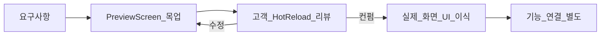

# Yggdrasill Design System

> UI/디자인 관련 작업 전 **반드시** 이 문서를 읽는다.  
> Cursor Rule: [`.cursor/rules/design-system.mdc`](../.cursor/rules/design-system.mdc)  
> 마지막 업데이트: 2026-07-30 | 담당: (고객 — 인터뷰 후 이름 기입)

---

## 0. 에이전트 필수 체크리스트

작업 시작 전 아래를 확인한다.

- [ ] 이 문서(`docs/design-system.md`) 전체를 읽었다
- [ ] 적용 대상 앱을 확인했다 (`yggdrasill` / `yggdrasill_manager`)
- [ ] §6 기준 화면(Golden Screens) 표를 확인했다
- [ ] **Preview 목업**으로만 UI를 작업한다 (고객 컨펌 전 프로덕션 `*_screen.dart` 수정 금지)
- [ ] 문서·기존 상수에 없는 **새 색상 / 폰트 / radius / spacing** 토큰을 만들지 않는다
- [ ] 기존 컴포넌트(§5) 재사용을 우선한다
- [ ] UI 변경과 기능(Provider, API, `onTap` 비즈니스 로직)을 분리한다
- [ ] 작업 완료 후 §10 변경 이력에 한 줄을 추가한다

---

## 1. 브랜드·UX 원칙 (고객 작성 — 인터뷰 후 채움)

아래 항목은 [§ 부록: 고객 인터뷰](#부록-고객-인터뷰-질문) 답변을 받은 뒤 채운다.

| 항목 | 내용 |
|------|------|
| 톤앤매너 | 깔끔, 통일성, 세련됨, ios |
| 정보 밀도 | 보통통 |
| 주 사용자 / 사용 환경 | 학원 선생님 / 13인치 아이패드와 27인치 windows 환경경  |
| 참고 앱·서비스 | spotify,  |
| 피하고 싶은 느낌 | _(미작성)_ |
| 강조색 `#33A373` | _(미작성 — 브랜드 고정 / 추후 변경 가능)_ |
| 절대 하지 말 것 | _(미작성)_ |

---

## 2. 팔레트 (현재 코드 스냅샷 — 추후 교체 용이)

**원칙:** 지금은 **현 상태 유지**. 색은 이 표에 HEX를 기록해 두고, 변경 시 표 → 코드 상수 순으로 동기화한다.  
장기 목표: `lib/theme/` 또는 monorepo `packages/`로 일원화 (아직 미구현).

### 2.1 레거시 메인 셸 (`main.dart` ThemeData)

소스: [`apps/yggdrasill/lib/main.dart`](../apps/yggdrasill/lib/main.dart) (약 L1076–1122)

| 토큰명 | HEX | 용도 |
|--------|-----|------|
| `scaffoldBackground` | `#1F1F1F` | 메인 Scaffold / AppBar 배경 |
| `navRailIndicator` | `#0F467D` | NavigationRail 선택 인디케이터 |
| `fabPrimary` | `#1976D2` | FloatingActionButton |
| `tooltipBg` | `#1F1F1F` | Tooltip 배경 |
| `tooltipBorder` | `Colors.white24` | Tooltip 테두리 |
| `navIconSelected` | `#FFFFFF` | NavRail 선택 아이콘 (size 30) |
| `navIconUnselected` | `#FFFFFF` @ 70% | NavRail 비선택 아이콘 |

**레이아웃 (Theme):**

| 항목 | 값 |
|------|-----|
| AppBar `toolbarHeight` | 80 |
| NavRail `minWidth` | 84 |
| Material | 3 (`useMaterial3: true`) |

### 2.2 신형 다크 틸 (`dialog_tokens` / 패널·다이얼로그)

소스: [`apps/yggdrasill/lib/widgets/dialog_tokens.dart`](../apps/yggdrasill/lib/widgets/dialog_tokens.dart)

| 토큰명 (코드) | HEX | 용도 |
|---------------|-----|------|
| `kDlgBg` | `#0B1112` | 다이얼로그·패널 배경 |
| `kDlgPanelBg` | `#10171A` | 패널 내부 |
| `kDlgFieldBg` | `#15171C` | 입력 필드 배경 |
| `kDlgBorder` | `#223131` | 테두리 |
| `kDlgText` | `#EAF2F2` | 본문 텍스트 |
| `kDlgTextSub` | `#9FB3B3` | 보조 텍스트 |
| `kDlgAccent` | `#33A373` | 강조(초록) |
| `_chipSelected` | `#1B6B63` | 필터 칩 선택 |
| `_chipBg` | `#2A2A2A` | 필터 칩 비선택 배경 |
| `_chipText` | `#CDD5D5` | 필터 칩 비선택 텍스트 |

**동일 팔레트 — private 복제 (`right_side_sheet.dart`):**

| private 상수 | HEX | = dialog_tokens |
|--------------|-----|-----------------|
| `_rsBg` | `#0B1112` | `kDlgBg` |
| `_rsPanelBg` | `#10171A` | `kDlgPanelBg` |
| `_rsFieldBg` | `#15171C` | `kDlgFieldBg` |
| `_rsBorder` | `#223131` | `kDlgBorder` |
| `_rsText` | `#EAF2F2` | `kDlgText` |
| `_rsTextSub` | `#9FB3B3` | `kDlgTextSub` |
| `_rsAccent` | `#33A373` | `kDlgAccent` |

### 2.3 기타 반복 색상

| HEX | 용도 | 소스 |
|-----|------|------|
| `#151C21` | PillTabSelector 트랙 배경 | `pill_tab_selector.dart` |
| `#1B6B63` | PillTab / CustomTabBar 인디케이터 | `pill_tab_selector.dart`, `custom_tab_bar.dart` |
| `#7E8A8A` | PillTab 비선택 라벨 | `pill_tab_selector.dart` |
| `#2A2A2A` | SnackBar 배경 | `app_snackbar.dart` |
| `#0B1112` | CustomNavigationRail 배경, DarkPanelRoute | `navigation_rail.dart`, `dark_panel_route.dart` |
| `#223131` | CustomNavigationRail indicator | `navigation_rail.dart` |
| `#EAF2F2` | CustomNavigationRail 아이콘 | `navigation_rail.dart` |
| `#1976D2` | 업데이트 UI primary (배포) | `tools/RELEASE_GUIDE.md` |
| `#232326` | 업데이트 UI surface (배포) | `tools/RELEASE_GUIDE.md` |

### 2.4 화면 유형별 사용 규칙 (현 상태 유지)

| 화면 유형 | 사용 팔레트 | 비고 |
|-----------|-------------|------|
| 메인 셸 (NavRail, Scaffold, AppBar) | **레거시** §2.1 | `#1F1F1F` — 무단 변경 시 고객 승인 |
| 다이얼로그 / RightSideSheet / DarkPanel / 학습 패널 | **신형 티** §2.2 | `dialog_tokens` / `_rs*` 우선 |
| Pill·밑줄 탭 | §2.3 공통 | `#151C21`, `#1B6B63` |
| SnackBar | `#2A2A2A` | `showAppSnackBar` |
| 신형 Nav (`CustomNavigationRail`) | `#0B1112` 배경 | 레거시 Theme NavRail과 **공존** — 혼용 주의 |

**금지:** 레거시 Scaffold에 신형 틀 배경을 무단 적용하거나, 그 반대 (§9 참고).

### 2.5 동일 HEX 중복 정의 목록 (일원화 대비)

| HEX 세트 | 정의 위치 |
|----------|-----------|
| `kDlg*` 7색 | `dialog_tokens.dart` (canonical) |
| `_rs*` 7색 | `right_side_sheet.dart` |
| `_rs*` 복제 | `file_shortcut_tab.dart` (주석: private 접근 불가로 중복) |
| `_rsBg` 등 | `problem_bank_view.dart` (로컬 static) |

색상 변경 시 **위 파일들을 함께** 검색·동기화할 것.

### 2.6 색상 변경 시 절차

1. 이 문서 §2 표의 HEX 수정
2. `dialog_tokens.dart` 및 §2.5 목록의 중복 파일 동기화
3. Preview 목업에서 영향 화면 스모크 확인
4. 고객 승인 후 프로덕션 반영
5. §10 변경 이력 기록

### 2.7 Light / Dark 대응 원칙

화이트모드 대응은 새 화면부터 **역할 토큰(semantic token)** 기준으로 작성한다.
개별 위젯에서 `Color(0xFF...)`를 직접 고르는 방식은 다크모드 고착을 만든다.

| 역할 | Dark 예시 | Light 예시(초안) | 사용처 |
|------|-----------|------------------|--------|
| `surfaceBase` | `#000000` (확정) | `#FFFFFF` | 화면 배경 |
| `surfacePanel` | `#10171A` | `#FFFFFF` | 카드/패널 |
| `surfaceField` | `#15171C` | `#F0F3F2` | 입력 필드 |
| `borderSubtle` | `#223131` | `#D9E2DF` | 구분선/테두리 |
| `textPrimary` | `#EAF2F2` | `#17201F` | 본문 |
| `textSecondary` | `#9FB3B3` | `#60706D` | 보조 텍스트 |
| `accentPrimary` | `#33A373` | `#1D8B61` | 주요 액션 |

**규칙**

- 새 UI는 `Theme.of(context).colorScheme` 또는 역할 토큰만 사용한다.
- 기존 `kDlg*`, `_rs*`는 Dark 역할 토큰의 현재 구현으로 본다.
- Light 대응 시 화면별 HEX 치환이 아니라, 먼저 역할을 정하고 토큰 값을 교체한다.
- Preview 앱: **Space** — Light / Dark 전환, **Enter**(Dark만) — `surfaceBase` 다크 후보 순환. 토큰: [`ygg_semantic_colors.dart`](../apps/yggdrasill/lib/theme/ygg_semantic_colors.dart).

---

## 3. 타이포그래피

소스: [`main.dart`](../apps/yggdrasill/lib/main.dart), [`pubspec.yaml`](../apps/yggdrasill/pubspec.yaml)

| 역할 | 폰트 패밀리 | Theme / 용도 |
|------|-------------|--------------|
| 본문·라벨 | `KakaoSmallSans` | `fontFamily` 기본, `body*`, `label*` |
| 제목·헤드라인 | `KakaoBigSans` | `display*`, `headline*`, `title*` |
| 문제은행·PDF | `HCRBatang`, `KoPubWorldBatangPro`, `ChosunNm` 등 | 도메인별 — UI 공통 규칙과 분리 |

**코드에서 자주 쓰는 실측 예시:**

| 용도 | fontSize | fontWeight | 출처 |
|------|----------|------------|------|
| 다이얼로그 섹션 제목 | 15 | w800 | `YggDialogSectionHeader` |
| 필터 칩 라벨 | 13 | w600 | `YggDialogFilterChip` |
| PillTab 라벨 | 17 (기본) | w600 | `PillTabSelector` |
| CustomTabBar 라벨 | (탭별) | — | `custom_tab_bar.dart` |

**금지:** UI 화면에 문서·Theme에 없는 새 폰트 패밀리 추가 (도메인 PDF/문제 렌더링 제외).

---

## 4. Spacing & Radius

**허용 spacing 스케일:** `4`, `8`, `10`, `12`, `16`, `24`  
임의 값(예: 13, 17, 19px padding)은 **새 UI에 사용 금지**. 기존 화면에 이미 있으면 Preview 리팩터 시 스케일로 맞출 것.

| 토큰 / 패턴 | 값 | 출처 |
|-------------|-----|------|
| 섹션 헤더 `padding` | `bottom: 10`, `top: 2` | `YggDialogSectionHeader` |
| 섹션 헤더 악센트 바 | `4×16`, radius `2` | `YggDialogSectionHeader` |
| 아이콘 간격 (헤더) | `10`, `8` | `YggDialogSectionHeader` |
| 필터 칩 padding | `horizontal: 14`, `vertical: 8` | `YggDialogFilterChip` |
| 필터 칩 height | `36` | `YggDialogFilterChip` |
| 필터 칩 radius | `18` | `YggDialogFilterChip` |
| PillTab 기본 크기 | `288×48`, padding `4` | `PillTabSelector` |
| PillTab radius | `height/2` (캡슐) | `PillTabSelector` |
| CustomTabBar 높이 | `48` | `CustomTabBar` |
| CustomTabBar 탭 너비·간격 | `120`, gap `21` | `CustomTabBar` |
| CustomTabBar 인디케이터 | `6` 높이, radius `3` | `CustomTabBar` |
| NavRail leading padding | `top: 6`, `bottom: 8` | `navigation_rail.dart` |
| Nav 아이콘 size | `26` (rail), `30` (Theme legacy) | `navigation_rail.dart`, `main.dart` |
| DarkPanel 전환 | `280ms` / `220ms` reverse | `dark_panel_route.dart` |
| 칩 애니메이션 | `160ms` | `YggDialogFilterChip` |
| PillTab 애니메이션 | `250ms`, `easeOutCubic` | `PillTabSelector` |

---

## 5. 컴포넌트 카탈로그 (재사용 우선)

경로 기준: `apps/yggdrasill/lib/widgets/` (unless noted)

| 컴포넌트 | 파일 | 언제 쓰나 |
|----------|------|-----------|
| `YggDialogSectionHeader` | `dialog_tokens.dart` | 다이얼로그 섹션 제목 |
| `YggDialogFilterChip` | `dialog_tokens.dart` | 다이얼로그 필터·토글 칩 |
| `PillTabSelector` | `pill_tab_selector.dart` | Pill + 슬라이딩 인디케이터 탭 |
| `CustomTabBar` | `custom_tab_bar.dart` | 밑줄 인디케이터 탭 |
| `CustomNavigationRail` | `navigation_rail.dart` | 신형 틀 좌측 네비 (`#0B1112`) |
| `DarkPanelRoute` | `dark_panel_route.dart` | 풀스크린 다크 패널 전환 |
| `showAppSnackBar` | `app_snackbar.dart` | 짧은 피드백 메시지 |
| `CustomFormDropdown` | `custom_form_dropdown.dart` | 폼 드롭다운 |
| `ClassCard`, `StudentCard`, `TeacherCard` | `class_card.dart` 등 | 엔티티 카드 |
| `MainFab` / `MainFabAlternative` | `main_fab.dart` 등 | FAB 패턴 |
| RightSideSheet 계열 | `right_side_sheet/` | 우측 시트·채점·메모 |
| PDF 다이얼로그 | `pdf/*.dart` | 교재·숙제 뷰어 |
| `CoverOverlayStyle`, `CoverScrim`, `CoverHairline`, `CoverPill` | `cover_overlay.dart` | 표지 이미지 위에 정보를 올리는 카드 (§5.1) |
| `TimetableCell`, `TimetableCapacityBand` | `screens/timetable/views/components/timetable_cell.dart` | 시간표 칸·인원 단계 띠·오버레이 칩 (§5.2) |

**금지:** 위와 **동일 역할**의 새 위젯을 임의 생성. 필요 시 기존 위젯 확장 또는 고객 승인.

**아이콘:** `material_symbols_icons` (`Symbols.*`) — Material Icons와 혼용 시 기존 화면 톤 유지.

### 5.1 표지 오버레이 카드 (고객 승인 스타일, 2026-10-08)

교재 표지·출력물·단색 배경 **위에 글자를 직접 올리는** 카드는 모두 이 규칙을 따른다.
기준 구현: 채점모드 과제카드(`_SubmittedHomeworkCard._buildCoverArea`)와 정답리스트 교재 카드(`_GradingAnswerBookCard`), 둘 다 `grading_mode_page.dart`.
새 화면에서도 같은 위젯(`cover_overlay.dart`)을 가져다 쓰고, 색·알파값을 화면에서 새로 고르지 않는다.

**핵심 원칙**

1. **표지는 가리지 않는다.** 전체를 덮는 어두운 막 대신 위·아래 **띠만** 어둡게 한다(`CoverScrim`). 표지 중앙은 원본 그대로 보인다.
2. **정보는 위·아래 두 묶음.** 위쪽은 카드를 **고르는 기준**(학생 이름, 상태 배지, 학년), 아래쪽은 카드의 **내용**(페이지·과제번호, 교재명·설명). 가운데 영역에는 글자를 두지 않는다.
3. **한 줄 정렬.** 모든 정보는 같은 여백 안에서 **왼쪽 정렬**한다. 가운데 정렬·오른쪽 끝 단독 배치를 섞지 않는다.
4. **짧은 값은 배지로.** 경과시간·종류·번호·학년처럼 짧은 값은 글자만 띄우지 말고 `CoverPill`에 넣는다. 배지가 대비를 보장하므로 어떤 표지에서도 읽힌다.
5. **글자 그림자는 은은하게.** 흰 글자에만 `blur 10, 검정 42%(이미지) / 18%(단색)`. 진한 외곽 그림자 금지.
6. **밝은 표지는 반전.** 출력물·밝은 단색 표지는 흰 띠 + 검은 글자(`#111418`) + 흰 배지로 자동 전환(`CoverOverlayStyle.onDark = false`).

**수치**

| 항목 | 값 |
|------|-----|
| 카드 반경 | `FabTabBarTokens.previewAcademyGroupedCardRadius` (28) — 자료메뉴 교재 카드와 동일 |
| 가장자리 여백 | `16` (카드 축소 시 `CoverOverlayStyle.padFor(scale)`, 최소 10) |
| 묶음 안 간격 | `8` (`gapFor(scale)`, 최소 5), 같은 종류 여러 줄 사이 `2` |
| 위 띠 | 0 → 40% 지점에서 투명, 시작 알파 이미지 0.66 / 단색 0.30 / 밝은 표지(흰색) 0.88 |
| 아래 띠 | 56% 지점부터, 끝 알파 이미지 0.78 / 단색 0.36 / 밝은 표지(흰색) 0.92. 아래 글이 많으면 `bottomStart`를 앞당긴다(정답카드 0.42) |
| 안쪽 테두리 | 1px, 흰색 10% (밝은 표지 검정 8%), 카드와 같은 반경 |
| 제목 | `previewAcademyMainTitleStyle` 32 w700, 자간 -0.4 (`titleStyle(context)`) |
| 본문 줄(페이지 등) | Pretendard 22 w700, 자간 -0.2, 숫자 고정폭 |
| 설명 문단 | Pretendard 20 w400, 흰색 82% (`inkSecondary`) |
| 배지 | 높이 32 캡슐, 좌우 12(아이콘 있으면 왼쪽 10), Pretendard 17 w600, 아이콘 17 + 간격 6 |
| 배지 neutral | 검정 46% + 흰 테두리 16% (밝은 표지: 흰색 86% + 검정 테두리 8%) |
| 배지 accent | `#0F2A20` 88% + `kDlgAccent` 테두리 60%, 글자 `#9FE3C6`, 앞에 7px 점 (밝은 표지: `#E8F6EF` + 글자 `kDlgAccent`) |
| 식별 코드 배지 | `emphasize: true` → w700, 자간 0.8 |

**하지 말 것**

- 배지에 블러(`BackdropFilter`)를 쓰지 않는다. 카드가 여러 장 겹치는 목록에서 스크롤이 버벅인다.
- 표지 전체를 30% 이상 덮는 단색 막을 깔지 않는다(확인 대기·여는 중 같은 **상태 표시용 막은 예외**).
- 배지 종류를 늘릴 때 새 색을 만들지 말고 `CoverPillTone`(neutral / accent)에 먼저 맞춰 본다. 꼭 필요하면 tone을 추가하고 이 표를 갱신한다.

**사용 예**

```dart
final overlay = CoverOverlayStyle(onDark: !useDarkText, hasImage: hasImage);
Stack(fit: StackFit.expand, children: [
  coverImage,
  Positioned.fill(child: CoverScrim(style: overlay)),
  Positioned.fill(child: CoverHairline(style: overlay, radius: 28)),
  Positioned(left: 16, right: 16, top: 16, child: /* 제목 + CoverPill */),
  Positioned(left: 16, right: 16, bottom: 16, child: /* 본문 줄 + CoverPill */),
]);
```

### 5.2 시간표 인원 표시 — 단계 띠 (고객 승인 스타일, 2026-10-08)

시간 메뉴 시간표(`classes_view.dart` + `components/timetable_cell.dart`)의 시간대별 인원은 **3단계 띠**로 보여 준다.
비교 시안: Preview 허브의 `timetable_capacity_preview_screen.dart`(현재 히트맵 / ① 70% 통일 / ② 선 제거 / ③ 추천 중 ③ 채택).
1명 단위로 밝기를 바꾸던 히트맵은 칸마다 색이 달라 눈이 어지러워서 폐기했다.

**색 규칙 (세 가지뿐)**

| 의미 | 색 |
|------|-----|
| 인원 양 | 회색조 2단계만: 여유(정원 70% 미만) ink 6%, 혼잡(70~99%) ink 15% (다크: 흰색, 라이트: 검정) |
| 지금·오늘·선택 | `kDlgAccent` 초록 |
| 정원 도달 | 앰버 `#F2B45B` — 정원에 닿았을 때만 |

**수치**

| 항목 | 값 |
|------|-----|
| 단계 | `timetableCapacityLevel(인원, 정원)` — 0 비어 있음 / 1 여유 / 2 혼잡 / 3 정원. 정원은 `academySettings.defaultCapacity` |
| 띠 | 같은 단계가 이어지는 칸을 `TimetableCapacityBand` 하나로 묶는다. 위·아래 여백 `kTimetableBandInset`(6), 양 끝 3, 반경 10. 요일 행 Stack에서 칸 **뒤**에 그린다 |
| 정원 띠 | 앰버 16% 바탕 + 앰버 55% 테두리 1px |
| 세로선 | 정시(:00) 칸 왼쪽에만, `divider` 60%. 30분 칸 선은 없다 |
| 인원 숫자 | 왼쪽 12, 위 13, Pretendard 13 w700, 숫자 고정폭. 띠 시작 칸은 `panelStyle.title`(정원 띠는 앰버), 띠 안에서 인원이 바뀐 칸·마우스가 올라간 칸은 `hint`, 나머지는 숨김 |
| 시간 축 | 칸 숫자와 같은 왼쪽 12에 정렬. 정시 15 w700, 30분 13 w500, 모두 `hint`(지금은 초록), Pretendard 숫자 고정폭 |
| 요일 | Pretendard 17 w700 (`요일` 머리글은 13 w600 `hint`) |
| 호버 열 | 같은 시간 열 전체에 ink 3% |
| 휴식 | 사선(간격 10, ink 6%) + `휴식` 13 w600 `hint` |
| 선택·등록 대기 | `kDlgAccent` 12%, 드래그 중 파랑 18% (기존 동작 유지) |
| 보강·추가·시범·문의 칩 | 같은 모양 하나: 높이 27 캡슐, ink 6% 바탕 + ink 10% 테두리, 아이콘 14(`hint`) + 간격 6 + 글자 12.5 w600. 완료는 투명도 45%. 종류는 **아이콘으로만** 구분(보강 `replay`, 추가 `add`, 시범 `auto_awesome`, 문의 `help_outline`) |

**하지 말 것**

- 인원 구간마다 색을 바꾸지 않는다(초록·노랑·빨강 단계 금지). 양은 밝기, 경고는 앰버 하나.
- 인원 1명마다 밝기를 바꾸지 않는다. 회색은 여유·혼잡 2단계만 쓴다.
- 30분 칸마다 세로선을 다시 긋지 않는다. 띠가 끊겨 보인다.
- 칩 종류별로 바탕색을 다르게 주지 않는다. 구분은 아이콘이 맡는다.
- 칸 위에 별도 막대·리본·배지를 겹쳐 인원을 다시 표시하지 않는다.

---

## 6. 기준 화면 (Golden Screens) — 고객이 채움

디자인·리팩터 시 **이 화면들의 밀도·색·컴포넌트 사용을 우선 복제**한다.

| 화면명 | 파일 경로 | 왜 기준인가 | 스크린샷 |
|--------|-----------|-------------|----------|
| _(비어 있음)_ | | | |
| _(비어 있음)_ | | | |
| _(비어 있음)_ | | | |

**손대면 안 되는 화면 (레거시 유지):**

| 화면명 | 파일 경로 | 사유 |
|--------|-----------|------|
| _(비어 있음)_ | | |

---

## 7. Preview 목업 워크플로 (필수)



### 규칙

1. UI 변경은 **`lib/screens/design_preview/`** 또는 **`*_preview_screen.dart`** 에서 먼저 수행한다.
2. **mock 데이터만** 사용한다. Provider / API / 비즈니스 `onTap` 연결 금지.
3. **고객 컨펌 전** 프로덕션 `*_screen.dart` 및 기능 로직 파일 수정 금지.
4. 컨펌 후: **UI 위젯 트리만** 이식하고, diff는 최소화한다.
5. 기능 연결(상태, API)은 **별도 작업**으로 분리한다.

### Preview 실행 (완전 분리)

Preview는 본앱과 같은 `build/windows/.../Debug` 산출물을 공유하지 않도록
**별도 Flutter 앱**에서 실행한다.

```powershell
cd apps\yggdrasill_design_preview
flutter run -d windows
```

본앱 실행과 Preview 실행은 서로 다른 Flutter 프로젝트이므로 Windows DLL 잠금 충돌을 피한다.

시안 개수: 한 Preview 화면에 **최대 2~3안(A/B/C)**. 그 이상은 통일성 저하.

### 에이전트 프롬프트 템플릿

```text
docs/design-system.md를 먼저 읽고 준수해.
Preview 목업만 만들고, 프로덕션 *_screen.dart는 건드리지 마.
새 색상/폰트/spacing/radius를 만들지 말고 문서 §2~§4와 기존 위젯(§5)만 사용해.
기능 로직(Provider, API, onTap)은 연결하지 마.
```

### Preview 폴더 구조 (앱·M5 분리)

**학습앱** — `apps/yggdrasill/lib/screens/design_preview/`

```
design_preview/
  design_preview_hub_screen.dart
  yggdrasill/                    # 학습앱 화면 (설정 등)
    settings/
      settings_preview_screen.dart
  m5/                            # M5 기기 UI (바인딩 히스토리 등)
    README.md
```

**매니저앱** — `apps/yggdrasill_manager/lib/screens/design_preview/`

```
design_preview/
  design_preview_hub_screen.dart
  yggdrasill_manager/
    settings/
      management_settings_preview_screen.dart
```

**별도 창 (권장 — 실사용 디버그 앱과 동시 실행):**

| 터미널 | 명령 |
|--------|------|
| 본앱 | `cd apps\yggdrasill; flutter run -d windows` |
| 디자인 Preview | `cd apps\yggdrasill_design_preview; flutter run -d windows` |

Preview 루트에서 **학습앱 Preview** 또는 **매니저앱 Preview**를 선택한다.

---

## 8. 앱별 차이

| 항목 | yggdrasill | yggdrasill_manager |
|------|------------|-------------------|
| Scaffold 배경 | `#1F1F1F` + 신형 틀 혼용 | `#1F1F1F` |
| ColorScheme seed | (Theme 직접 색) | `#33A373` |
| 폰트 | KakaoSmallSans / KakaoBigSans | 동일 |
| dialog_tokens | 사용 | (화면별 확인) |
| 공통 규칙 | §2~§7 | §2~§7 + 본 표 |

매니저 앱 전용 예외는 추후 §8에 추가한다.

---

## 9. 안티패턴 (하지 말 것)

- 스크린샷·Figma만 보고 레이아웃 **전면 재설계** (기능 맥락 무시)
- 문서·`dialog_tokens`에 없는 `Color(0xFF...)` **신규 하드코딩**
- 레거시 Scaffold ↔ 신형 틀 팔레트 **무단 교차 적용**
- UI 작업 PR에 Provider / API / 대규모 `onPressed` 로직 변경 포함
- 동일 역할 위젯 중복 생성 (§5 무시)
- 컨펌 없이 프로덕션 화면 직접 수정
- spacing 스케일(§4) 밖 임의 값 남발

---

## 10. 변경 이력

| 날짜 | 변경 | 승인자 |
|------|------|--------|
| 2026-05-29 | 초안 생성 (코드 스냅샷, Preview 워크플로, Cursor Rule 연동) | — |
| 2026-05-29 | Preview 폴더 분리 (yggdrasill / manager / m5), 설정 목업·kDebugMode 라우트 | — |
| 2026-05-30 | 앱 내부 Preview 진입점 실험 (이후 완전 분리 방식으로 대체) | — |
| 2026-05-31 | `apps/yggdrasill_design_preview` 완전 분리 Preview 앱 생성 | — |
| 2026-06-02 | Preview 앱 Space 키 Light/Dark 전환, Light/Dark 역할 토큰 원칙 추가 | — |
| 2026-06-02 | `surfaceBase` ThemeExtension·Preview Enter 순환(`#0B1112`/`#1F1F1F`/`#000000`), Light `#FFFFFF` | — |
| 2026-06-02 | `surfaceBase` Dark `#000000` 확정, 설정 탭(학원/선생님/일반) 배경 토큰 적용 | — |
| 2026-06-03 | 채점모드 과제 카드: 문제은행 출처(추출 교재)는 표지 대신 어두운 회색(`#2B2B2B`) 배경 | — |
| 2026-06-03 | Preview 설정·학원 탭: 기준 본문 `16` (`FabTabBarTokens.previewAcademyBaseFontSize`), FAB 탭 라벨 동일 | — |
| 2026-06-26 | 매니저앱 문항 로드맵 초안 편집 화면 추가 | — |
| 2026-07-23 | 홈메뉴 숙제 초안: 효과가 이어지는 컴팩트 확장, 3줄 마감일, 우측 정렬 `숙제 내기` 버튼 | — |
| 2026-07-26 | 과제 추가 다이얼로그: 하위과제 리스트를 우측 패널에 임베드, 자동/수동 UI 분기, 교재 트리 뒤로가기 | — |
| 2026-07-30 | 홈 상단 출석 순위: `showUtilityGlassDialog` + 점수 점분포(beeswarm) | — |
| 2026-08-23 | 시간제한 테스트: 앱 과제양식 기본값, 제출 문항 수·현재 순번·남은 시간 중심 학생 응시 UI | 사용자 |
| 2026-08-23 | 채점 정답 리스트: 페이지를 카드와 같은 행이 아니라 가로선+본문색 섹션 구획으로 표시 | 사용자 |
| 2026-08-23 | 채점 시트: 같은 학생·교재의 아래 과제가 있으면 확인 후 연속 전환하는 `다음` 버튼 표시 | 사용자 |
| 2026-08-23 | 채점모드: 숙제 검사에서도 `다음` 연속 전환 지원, 당일 배정 미제출 숙제는 숨김 | 사용자 |
| 2026-09-28 | 매니저앱 Think 화면(대화·기억·사용량 탭) 추가, 설정 화면 OpenAI 키 입력 카드를 서버 비밀값 안내로 교체. 기존 매니저 팔레트만 사용 | 사용자(Preview 생략 요청) |
| 2026-09-29 | Think 대화 목록을 정리 트리(정리 안 됨·주제 폴더·발췌, 36px 행, 깊이당 16 들여쓰기, 끌어 옮기기)로 교체. 960px 미만에서는 56px 접힘 막대. 답변 머리에 제외·발췌 버튼, 제외 문답은 50% 투명. 기존 Think 팔레트만 사용 | 사용자(Preview 생략 요청) |
| 2026-09-29 | Think에 "코드 조사" 탭 추가(420px 요청 목록 + 상세, 상태 배지, 작업자 켜짐 점, 결과·제안·원문 접기). 답변 머리에 "코드 조사 요청" 버튼, 요청 작성 창(640px), 사용량 탭에 하루 한도 칸. 기존 Think 팔레트·간격만 사용 | 사용자(Preview 생략 요청) |
| 2026-09-30 | Think "코드 조사" 탭 제거, 채팅 안 카드(최대 760px, 반경 12)로 통합: 코드 조사·수정 제안, 코드 요청 진행·결과·diff(파일별 접기), 대화 분류 제안, 삭제 확인(빨간 테두리). 처리된 제안은 한 줄로 접음. 트리에 제안 폴더 강조(초록 테두리 + "제안")와 새 폴더 흐린 행, 맥락 패널에 "코드 작업" 칸, "전체 코드 요청" 창. 기존 Think 팔레트만 사용 | — (Preview 생략, 사용자 확인 필요) |
| 2026-10-01 | Think 채팅 카드에 "Cursor와 조율"(악수 아이콘, 회차 N/3, 회차별 "Think가 보낸 질문·반론")과 "조율본" 승인 카드(갈린 점은 인용 배경 상자에 Think/Cursor 두 줄, "정해 주셔야 할 것", 이대로 구현·고쳐서 구현·거절) 추가. 기존 카드 틀·Think 팔레트만 사용 | — (Preview 생략, 사용자 확인 필요) |
| 2026-10-02 | 조율본 카드에 객관식 질문 칸 추가: "질문 n" 머리, 보기 행(반경 8, 테두리 `kThinkBorder`/선택 시 `kThinkAccent`, 선택 배경 `kThinkQuote`, 라디오 아이콘 18, "추천" 배지 `kThinkSuccess`, 설명 12px), 직접 입력 칸(`thinkInputDecoration`), "n/m개 답함". 기존 Think 팔레트·간격(4/8/12/16)만 사용 | — (Preview 생략, 사용자 확인 필요) |
| 2026-10-05 | 코드 수정 카드: 끝나지 못한 수정(확인 필요·실패·취소)에 "같은 내용으로 다시 수정" 보조 버튼(`thinkOutlineButton`, `Icons.replay`)과 확인 창 추가 | — (Preview 생략, 사용자 확인 필요) |
| 2026-10-07 | 코드 수정 카드: "자동 검사" 칸(요약 한 줄 12px 굵게, 항목 줄 아이콘 16 + 이름·상태·이유, 상태색 통과 `kThinkSuccess`·실패 `kThinkError`·미실행 `kThinkHint`·원래도 실패 `kThinkLink`, 실패 항목은 펼침, 출력 상자 `kThinkQuote` 반경 8·최대 높이 240), 준비됨 안내를 검사 결과별 색으로, 적용 확인 창 맨 위 경고와 실패 시 빨간 "그래도 적용", 재수정 카드 머리 "검사 실패로 다시 고침 n회째". diff 영역 "검증 보고" 버튼 제거. 기존 Think 팔레트·간격만 사용 | — (Preview 생략, 사용자 확인 필요) |
| 2026-10-07 | 학습앱 하원 다이얼로그를 숙제 선택 창에서 요약 창으로 교체(`departure_summary_dialog.dart`): `UtilityGlassDialogShell`(반경 28) 안에 요약 한 줄, "숙제로 나감"·"다음 수업으로"(흐리게) 그룹 카드(`cardBg`/`cardBorder`), 검사일 칩, 알림장 칸(인쇄 스위치·미리보기·행동 체크/± 카운터), 하단 취소(Outlined)·하원(Filled `kDlgAccent`, Stadium 44). `YggDialogColors`·간격 4/8/10/12/16/24만 사용 | — (Preview 생략, 사용자 확인 필요) |
| 2026-10-08 | Think 채팅: 코드 블록(회색 상자 `kThinkField` 반경 8, 안쪽 12)을 가로 스크롤 대신 상자 폭을 채우고 긴 줄을 접게 바꿈(상자 안 어디서 끌어도 선택·복사). 입력창 안내에 "이미지는 Ctrl+V", 파일 없이 놓인 드롭은 오류 스낵바로 안내. 코드 카드에 "이어받는 앞 수정"·"이어받은 패치" 줄(12px `kThinkSub`, 안내 `kThinkHint`). 기존 Think 팔레트·간격만 사용 | — (Preview 생략, 사용자 확인 필요) |
| 2026-10-08 | 표지 오버레이 카드 규칙(§5.1)과 공용 위젯 `cover_overlay.dart` 추가. 채점모드 과제카드: 위·아래 띠 스크림, 이름 왼쪽 정렬, 경과시간(`n분 전`)·숙제·과제번호를 32px 캡슐 배지로, 페이지·과제번호를 아래쪽으로. 정답리스트 교재 카드: 반경 14→28, 같은 스크림·테두리, 학년 배지를 왼쪽 위 캡슐로(학년 여러 개면 전환 아이콘) | 사용자(Preview 생략 요청) |
| 2026-10-08 | 시간표 인원 표시를 히트맵으로 교체(§5.2): 칸 밝기 = 인원 ÷ 정원, 정원 도달만 앰버, 인원 숫자는 왼쪽 위(변화 시만 밝게), 호버 열 표시, 휴식 사선. 기존 막대·리본 표시 제거. 보강·추가·시범·문의 칩을 아이콘 + 중립 캡슐 하나로 통일 | 사용자(Preview B안 선택) |
| 2026-10-08 | 히트맵이 어지러워 단계 띠로 교체(§5.2): 회색 2단계(여유·혼잡) + 정원 앰버, 같은 단계는 둥근 띠 하나로, 세로선은 정시만, 숫자는 띠 시작(밝게)·띠 안 변화(흐리게)만. 시간 축을 칸 숫자 선에 왼쪽 정렬(정시 15 w700 / 30분 13 w500), 요일 17 w700, 모두 Pretendard | 사용자(Preview ③ 선택) |
| 2026-10-09 | Think 대화 나누기: 나누기 카드(다섯 칸 요약, 빈 칸은 `kThinkHint` "없음", 나눠서 이어가기·고쳐서 나누기·여기서 계속하기, 막힌 이유 문구, 만료·거절은 한 줄), 고치기 창(제목·폴더·요약 다섯 칸), 나눈 대화 위쪽 안내(`kThinkQuote` 반경 8, `Icons.call_split`, 요약 접기·최대 높이 280, "원본 대화로 가기"), 복사한 메시지 위 "원본 대화에서 복사한 메시지" 줄, 맥락 패널 "대화 나누기" 칸(기능 상태·제안 받기 토글·"연결·기능 상태 보기" 버튼), 상태 창 "기능 상태"(사용 가능 `kThinkSuccess` / 준비 필요 `kThinkLink` / 확인 불가 `kThinkError`). 기존 Think 팔레트·간격만 사용 | — (Preview 생략, 사용자 확인 필요) |
| 2026-10-10 | Think 커서 문의: Cursor가 보낸 질문 위에 `Icons.smart_toy_outlined` 14 + 배지 "커서가 물음 / 작업자 커서가 물음"(`kThinkLink`), 답변 아래 판정 상자(`kThinkBg` 반경 8, 테두리 60% — "기존 결정 근거" `kThinkSuccess` + 근거 기억 제목 / "사장님 확인 필요" `kThinkAccent` + 확인 질문, 13px `kThinkSub`), 트리의 커서 대화 행은 같은 아이콘 `kThinkLink`와 툴팁. 사용량 기능 이름 "커서 문의 답변". 기존 Think 팔레트·간격만 사용 | — (Preview 생략, 사용자 확인 필요) |
| 2026-10-11 | 학생 메뉴 페이지 타이틀: 홈 '수업 현황'과 같이 제목은 학생·성향이 같은 줄(아이콘 40, 간격 20, 색 `title`). 학생은 Member, 성향은 Puzzle(제목 채움 2790). 성향 탭은 우측 캡슐이 없어도 줄 높이 58을 유지해 제목 Y를 학생 탭과 같게 함. 하단 탭은 홈과 같이 32px, 평소 선·선택 시 채움(학생 21997/22115, 성향 1775/2790) | 사용자(Preview 생략, 바로 적용 요청) |
| 2026-10-10 | 홈 수업 현황 머리: 등원 수 옆에 공부중·휴식중·제출을 같은 줄에 추가. 라벨 15 `hint` w500, 숫자 18 `title` w700 Pretendard, 사이 구분선은 `hint` 28%. 항목마다 새 색 없음. 공부중·휴식중은 등원 카드와 같은 기준(미완료 과제 수행 여부), 제출은 채점 대기 과제 수 | 사용자(Preview 생략, 바로 적용 요청) |
| 2026-10-10 | Think 코드 제안·조율본 카드에 "Cursor 작업 강도" 선택(`ThinkEffortPicker`): 기존 `ThinkToggleChip` 3개(보통·medium / 높음·high / 최고·xhigh, 아이콘 `signal_cellular_alt_1_bar`·`_2_bar`·`signal_cellular_alt`, 툴팁에 기준), 아래 12px `kThinkSub`로 Think 판단 이유와 "틀릴 수 있음"/"바꾼 강도로 보냄" 안내. 보낸 요청의 요청 내용에 "요청한 작업 강도", 회차 정보에 "모델 · 강도 X". 기존 Think 팔레트·간격만 사용 | — (Preview 생략, 사용자 확인 필요) |
| 2026-10-10 | Think 코드 카드: 시간 제한으로 멈춘 패치를 이어받은 요청은 제목 아래 기존 `ThinkNotice`(`kThinkAccent`, `warning_amber_outlined`)로 "미완성 패치에서 시작: … 검사된 적이 없습니다" 경고, 회차 칸 제목 "미완성 패치에서 시작"과 12px `kThinkHint` 안내. 요청 내용 문구 "최종 패치" → "마지막 패치". 기존 Think 팔레트·간격만 사용 | — (Preview 생략, 사용자 확인 필요) |
| 2026-10-11 | Think 역할: CustomPainter 아바타 4종(총괄 별 `kThinkAccent`·교육 책 `kThinkSuccess`·제품 카드 `kThinkLink`·개발 꺾쇠 괄호 `kThinkBlue`, 답하는 중 고리 맥동, 모션 감소면 고정 고리), 대화 위 역할 머리("Think(역할)" 14 w700, 역할 칩 Stadium·선택 시 역할색 16% 배경, 720px 미만은 아바타+툴팁, 부서 역할이면 `ThinkToggleChip` "다른 부서 참조", 잠김·새 대화 안내 12px `kThinkHint`), 답변 머리 "이 답변에 쓴 자료 보기"(`library_books_outlined`)와 맥락 패널 자료 칸(실제 전달 자료 배지 기억/문서, "앞부분만", 스냅샷 없으면 "기록 없음", 연결 자료와 연결·해제·검색 창), 기억 범위 선택(`ThinkToggleChip` 공통/부서 3개, 레거시는 레거시 기억에만, 역할 제안은 "적용" 버튼). "생각하는 중…" → "응답 준비 중…", "마지막 답변" 기술 정보 접기. Preview `ThinkRolesPreviewScreen`(매니저 Preview 허브 "Think 역할"). 기존 Think 팔레트·간격만 사용 | — (Preview 추가, 사용자 확인 필요) |

---

## 부록: 고객 인터뷰 질문

§1·§6을 채우기 위한 질문. 답변을 주시면 본문에 반영한다.

### A. 브랜드·느낌

1. 앱을 한 문장으로 설명하면?
2. 참고하고 싶은 앱/서비스 1~3개?
3. 피하고 싶은 느낌?
4. 강조색 `#33A373` — 브랜드 고정 vs 추후 변경 가능?

### B. 정보 밀도·레이아웃

5. 정보 많이 vs 여백 많이?
6. 카드/리스트 행 높이 선호 (촘촘 vs 큰 터치 영역)?
7. 다이얼로그 최대 너비·패딩 선호?

### C. 기준 화면

8. "제일 잘 됐다"는 화면 3~5개 (파일 경로)?
9. "손대면 안 된다" 화면?

### D. Preview·승인

10. Preview 진입 방식: (a) 설정 숨김 (b) `kDebugMode` (c) `--dart-define`
11. 한 번에 시안 몇 개까지? (권장 2~3)

### E. 접근성·플랫폼

12. 최소 글자 크기 / 고대비 요구?
13. Windows만 vs 태블릿/웹 추후 고려?
